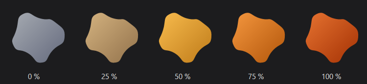

# Ocre

A keyboard-driven warm light filter for Windows 11.
*Version francaise : [README.md](README.md).*



| | Primary set | Fallback set |
|---|---|---|
| weaker filter | `Ctrl+F5` | `Ctrl+Alt+Backspace` |
| stronger filter | `Ctrl+F6` | `Ctrl+Alt+Enter` |
| toggle off / on | `Ctrl+F7` | `Ctrl+Alt+Space` |

Both sets are active at the same time and fully reconfigurable. The primary
set requires the laptop's Fn-lock to be in *function key* mode (see below);
the fallback set uses no function key and works everywhere.

`Ctrl+Alt` + **mouse wheel** adjusts the intensity continuously: a setting
like this is found rather than typed, and no key gives that kind of
progression. The same wheel with **`Shift`** added adjusts the brightness.
And the wheel **over the icon** next to the clock, with nothing else, adjusts
the intensity too.

A **left click** on the icon opens the settings; a **right click** opens a
small panel where intensity, brightness and three presets are within reach
without opening anything; a **middle click** turns the filter off or back on
-- Ctrl+F7 for whoever has a hand on the mouse. The interface is in French
and English.

Intensity is shown in **percent or Kelvin** -- 3400 K means something to
anyone coming from f.lux or Night Light, 58 % means nothing. A click on the
value at the top of the right-click panel switches between the two; it is the
only place where this is chosen. Only the display changes: the slider, the
shortcuts and the configuration file still count in percent.

Inside the windows, the **arrow keys** adjust the focused slider, `Tab` moves
to the next one, `Home` and `End` go to the ends, `Escape` closes.

Everything can also be driven from the command line -- `Ocre.exe /set 40`,
`/kelvin 3400`, `/preset night`, `/get` -- for a button box or a macro.

---

## Why Ocre does not use the Windows Night Light

That was the original plan, and it failed for a reason worth documenting,
because it invalidates every existing tool on recent builds.

Night Light has no API. Its setting is persisted in two `REG_BINARY` values
under `HKEY_CURRENT_USER`, in **Microsoft Bond CompactBinary v1** format
wrapped in a **CloudStore** envelope. All the community literature states
that writing these values applies the setting immediately.

**This is no longer true since Windows 11 25H2 (build 26200).** Measured on
an Acer Aspire 14 AI, 25H2 build 26200.9168:

| Observation | Consequence |
|---|---|
| This repository's codec produces **exactly the same bytes** as Windows for a given temperature | the format is correctly understood |
| Settings reads back the written value (the slider follows) | the write succeeds |
| The on-screen rendering does not change | the engine does not re-read the registry |
| "Turn off now" does **not even** write the state key | the live state no longer lives in CloudStore |

Tried without success: writing the temperature alone, rewriting the state
key with a fresh timestamp, an off/on cycle with delays from 120 ms to 2.5 s,
and the "adjustment in progress" flag (field 70) that the UI raises while the
slider is being dragged.

Conclusion: on these builds, the registry is a persistence remnant, read at
logon and never again.

Cross-check the other way round, by switching Night Light on then off by
hand from quick settings while watching the keys:

| Key | Content | Written |
|---|---|---|
| `Store\...\Cloud\...state` | a timestamp alone, no state | on every toggle |
| `Store\...\Current\...state` | "forced ON" dated two days earlier | touched on toggle, **content unchanged** |
| `Store\...\Current\...settings` | schedule, temperature | never |

Windows therefore records *that* a toggle happened, not *which*. That is why
Ocre cannot see a Night Light switched on by hand (see
[the banner](#when-a-windows-filter-adds-up)).

The codec remains in [`recherche/`](recherche/): it is correct, tested, and
still lets you **preset** Night Light for the next logon.

## What Ocre does instead

A gamma ramp, through `SetDeviceGammaRamp`. It applies instantly and depends
on no service.

The usual objection is that Windows clamps the amplitude of ramps. That is
true by default, and it can be **turned off**:

```
HKLM\SOFTWARE\Microsoft\Windows NT\CurrentVersion\ICM
  GdiIcmGammaRange  (REG_DWORD)  =  256
```

A new logon is required afterwards. `install.ps1` takes care of it.
[`tools/test-clamp.ahk`](tools/test-clamp.ahk) checks that the requested ramp
is applied as is, by reading it back after writing.

### The curve

[`lib/Gamma.ahk`](lib/Gamma.ahk) starts from Tanner Helland's approximation
(colour temperature to RGB) with two corrections:

- **Normalisation.** At 6500 K the raw model returns (255, 254, 250), a warm
  residue at zero intensity. We divide by this reference so that 0 % is
  exactly the identity.
- **Extension.** The model plateaus: at 1200 K it still leaves green at 0.34,
  below the native Night Light at full strength. Beyond 60 % intensity, green
  is pushed down further, to 0.15. Below that, the rendering remains that of
  a true colour temperature.

The filter can only remove light: the higher the intensity, the darker the
screen. That is inherent to the method.

### Every screen

`GetDC(0)` gives the context of the whole desktop, but a ramp set on it only
affects the primary screen: on a two-screen machine, the external monitor
would stay blue while the laptop turns ochre. Ocre therefore enumerates the
displays attached to the desktop with `EnumDisplayDevices`, opens one context
per screen and sets the same ramp on each. A screen that refuses it -- some
external monitors have no gamma table -- does not deprive the others of the
filter.

The contexts stay open from one write to the next: reopening them on every
notch would cost more than the ramp itself, and the wheel asks for several
dozen per second. The watchdog closes them when the number of screens
changes.

**The same ramp everywhere is not always what you want, though.** A laptop
panel and an external IPS do not share the same native temperature: at 60 %
one turns orange while the other stays yellow, and no single setting suits
both. A *Set each screen separately* toggle then gives each its own intensity
and brightness.

It **only appears when there is something to choose**. On a single-screen
machine the question has no object, and a pointless toggle steals height
from a window that has none left. Plug in a second screen, reopen the
settings: the section is there, with a selector naming each monitor. Unplug
it, it goes away -- the setting stays written and becomes active again at the
next connection.

Once separated, a shortcut has to apply somewhere, and the two gestures do
not mean the same thing: **on the keyboard** you adjust the screen of the
active window, the one you are looking at; **with the wheel** the one it
hovers, since the hand is already there. The badge follows, and shows on the
screen concerned rather than always on the primary -- an answer that appears
behind you is no answer.

Recognising a screen from one session to the next needs a stable identifier.
It is the monitor's `DeviceID`, of the form
`MONITOR\ACR0429\{4d36e96e-...}\0001`, which carries the manufacturer code
and model read from the EDID; the numeric suffix separates two identical
units. Neither the `HMONITOR` nor the `\.\DISPLAY1` name will do: both change
with connections.

### Brightness

The ramp can also darken: a factor applied identically to the three channels,
so without shifting the hue. On a laptop it is a good method, because it
takes the screen **below the backlight minimum**, which the hardware cannot
do -- useful at night, when the lowest brightness is still too much.

On a desktop monitor it is the wrong one. The backlight stays at full and we
only crush the levels: black stops being black, contrast collapses. That is
the problem Twinkle Tray and Monitorian solve, and the only serious criticism
one could make of Ocre's slider.

The two complement each other instead of competing:

```
    100 %  ......  the hardware at full
      |            we lower the backlight
     25 %  ......  the hardware at its floor
      |            the gamma ramp takes over
      0 %  ......  as dark as this machine can go
```

Two mechanisms depending on the screen, with nothing in common. **DDC/CI**
(`dxva2.dll`) talks to the monitor over the video cable: it is the only way
for an external screen, and it is slow -- around fifty milliseconds per
write, where the wheel would ask for several dozen per second. Writes are
therefore batched over 120 ms, as the configuration file writes already
are. **WMI** (`WmiMonitorBrightnessMethods`) drives a laptop's built-in
panel; it is the same path as the Windows slider, hence the same setting: the
value found at startup is recorded and restored on exit, exactly like the
ramp.

The hardware floor is not the advertised minimum but a tenth of the range
above it. On many panels, zero switches the backlight off outright -- and a
black screen takes with it the control that would let you come back up. The
remaining tenth is rendered by the ramp, which itself never goes below 0.30
for the same reason.

The laptop's Fn keys and the Windows slider write the same value as Ocre. So
Ocre reads it back, every ten seconds and before quitting, and compares it to
what it last set. If it moved, someone else did it: Ocre **adopts** the
change -- its brightness slider realigns on it instead of overwriting it at
the next gesture -- and, on exit, only restores the morning's value if its own
is still in place. Restoring the morning's value over a setting made by hand
during the day was a surprise. Two units of tolerance absorb monitors that
round what they are written, without which 58 read back for 57 written would
pass for an external setting, be adopted, rewritten, read back, endlessly.
The read-back only happens if someone touched the keyboard or mouse since
the previous round: an Fn key is a key, the Windows slider takes a mouse,
and a DDC read costs thirty to a hundred milliseconds of I2C bus that some
monitors dislike being subjected to without pause.

A monitor with no brightness table, a driver that refuses, a corporate policy
that closes WMI: the slider then falls back on the ramp alone, and covers its
whole range with it. The bottom of the slider always means *as dark as
possible*, whatever the machine.
[`tools/sonde-ecrans.ahk`](tools/sonde-ecrans.ahk) tells you what yours can
do, without changing anything.

### And in HDR

Two Windows modes ignore the gamma table, for the same reason. In **HDR**,
Windows composes in 10- or 16-bit floating point and **no longer consults the
gamma table**: `SetDeviceGammaRamp` succeeds, and does nothing. Ocre would
set its ramp, the icon would tint, the badge would say "60 %" -- and the
screen would stay blue. The worst case for an application of this kind: a
silent failure.

The ramp multiplies each channel by a coefficient. **A compositor colour
matrix does exactly the same thing** -- that is the Magnification API, the
one Windows uses for its accessibility filters -- and the compositor also
runs in HDR. When a screen is in HDR, the tint therefore goes through this
matrix ([`lib/Compositeur.ahk`](lib/Compositeur.ahk)) instead of the ramp.
Measured in SDR, both paths give the same result to the digit: a white under
60 % is (255, 188, 133) either way. Grey is composed there by matrix
product.

Two things to know. The effect is **full screen**: in HDR, per-screen
settings apply to all, at the value of the screen being looked at. And in
HDR the compositor works in linear light where the ramp multiplied encoded
values: the coefficient is raised to the power 2.2 so that 60 % in HDR looks
like 60 % in SDR. That exponent is the theoretical value of the sRGB curve;
it has not yet been measured on a lit HDR screen.

Detection ([`lib/Hdr.ahk`](lib/Hdr.ahk)) deserves a word, because the first
API tried **lies**. `GET_ADVANCED_COLOR_INFO` (Windows 10) reports "advanced
colour active" for HDR as well as for automatic colour management (ACM),
which Windows 11 enables on its own on wide-gamut panels -- and which leaves
the ramp intact. On the development machine: flag at 1, HDR off, Ocre works.
Trusting it would have switched people for whom the ramp works perfectly
well over to the compositor. `GET_ADVANCED_COLOR_INFO_2` (Windows 11 24H2)
distinguishes SDR, WCG and HDR; that is the one we read. On an older Windows
we conclude "not HDR", and the `voie = compositeur` key in `ocre.ini` forces
the path by hand.

And WCG, the *automatic colour management* Windows 11 enables on its own on
wide-gamut panels? The ramp works there. We believed the opposite for a
while, and switched Ocre to the compositor as soon as WCG was on: the mouse
cursor, which the compositor's matrix does not touch, stayed white, and the
tint was weaker than with the ramp -- the compositor composes in linear under
WCG without the 2.2 exponent being applied. Measured by eye since: under
WCG, a (1; 0.3; 0) ramp set with `SetDeviceGammaRamp` tints the screen very
visibly. `Hdr.RampeIgnoree` therefore only switches in true HDR; in doubt,
the `voie` key of `ocre.ini` settles it by hand.

### The darkroom

A cousin of f.lux's *Darkroom* mode: the image rendered on the red channel
only. What is dark stays black, what is light turns red, and the screen only
emits the light that least disturbs dark-adapted vision. With applications in
dark mode, that is red text on a black background -- the intended effect,
and nothing else.

f.lux also inverts the image. That was designed for white backgrounds, which
became black; on applications that are already dark, the inversion does the
opposite of the goal, every black background turning bright red -- and
photos go negative. Ocre does not invert.

It is one more matrix set by the compositor (`Compositeur.CHAMBRE`), and a
session state: no shortcut, no box in the settings, no key in `ocre.ini`, and
a session always opens in colour. Only one line of the right-click panel
leads into it and out of it. Brightness keeps darkening; grey has nothing
left to do and is not composed.

### Forcing the filter back

A full-screen game, a wake from sleep or a colour-mode change can wipe out
the compositor effect, which the watchdog does not monitor the way it does
the ramp. Three things restore it: the `WM_DISPLAYCHANGE` family of messages
call `Filtre.Forcer`, which clears the HDR/WCG detection and the compositor
cache before reapplying; a **Reapply** button, next to the greyscale box,
does the same by hand; and `Ocre.exe /gris` toggles grey alone, handy for a
quick check.

### Watchdog

Windows resets the ramp by itself after a wake from sleep, a resolution
change, a UAC prompt or the exit of a full-screen game.

Three of these four cases announce themselves, and Ocre listens rather than
waits: `WM_DISPLAYCHANGE` for resolution and screen connections,
`WM_POWERBROADCAST` for sleep, `WM_WTSSESSION_CHANGE` for locking and session
switching. The ramp is then back within the millisecond. Since the driver
has not always finished reconfiguring the display when the message arrives,
it is set a second time 1.2 s later: one write too many costs nothing, one
too early is lost.

That leaves the UAC prompt, which announces nothing. A poll every 10 seconds
covers it, and now serves only for that.

## The scheduler

Two moments in the day: the one where the rise toward the night intensity
begins, the one where the descent toward the day intensity begins. Between
the two, nothing moves.

The fade is deliberately long -- three hours by default, where tools of this
kind offer twenty seconds or an hour. At that length the intensity rises by
one point every three minutes: the eye follows without ever noticing, and
that is the whole point. A short fade is noticed, and that is precisely what
these tools are criticised for.

It is **off by default**. Setting your filter by hand is a perfectly
legitimate preference, and a program that moves on its own the first evening
gets uninstalled the next day.

A manual adjustment during a fade suspends the scheduler until the next
switch: otherwise the chosen value would be overridden three minutes later,
which feels like a program fighting its user.

The suspension is visible: the icon's tooltip says "schedule paused until
07:00", and the right-click panel then carries a *Resume the schedule* line
that sets the intensity of the hour without waiting. A scheduler that goes
quiet without saying so looks like a broken scheduler.

The day intensity has no control in the window: it is zero, that is, filter
off, in about every case where one wants a schedule. Whoever insists on a
touch of filter in broad daylight sets `h_jour` in `ocre.ini`.

### Following the sun

A fixed schedule drifts, and that was the only serious flaw of the scheduler
as it was. In Paris the sun sets at **17:00 in December and 21:55 in June**:
a rise pinned at 21:00 all year is four hours late half the time. The
three-hour fade then loses the anchor that justifies it -- it drifts by more
than its own length.

The *Sun* mode, at the top of the scheduler window -- next to *Manual* and
*Fixed hours* -- replaces the two times by two offsets: so many minutes
after sunset, so many after sunrise. Zero by default, negative to start
earlier. The three modes used to be spread between a toggle here and one
there, and you needed both to know where you stood; the *Follow a schedule*
toggle of the main window stays, and follows -- it means "not manual".

The calculation is NOAA's, in [`lib/Soleil.ahk`](lib/Soleil.ahk). It only
needs the date and a point on the globe: **no network, no service, nothing to
keep up to date**. The zenith used is 90.833 degrees -- the 90 geometric
degrees plus 0.833 for atmospheric refraction and the disc's half-diameter,
which is the convention for official sunrise and sunset.

It runs in two passes. The first takes the sun's position at 0 h UTC, which
is enough at our latitudes. Higher up, the sun skims the horizon: it takes an
hour to cross it where it takes ten minutes in Paris, and the declination at
midnight is no longer that of sunset. Measured against an independent
implementation: **4 minutes of error at Tromso and Reykjavik in September,
brought down to one by the second pass**, which recomputes the position at
the time found by the first.

[`tools/test-soleil.ahk`](tools/test-soleil.ahk) checks eighteen cases
against values produced by the Python library *astral*, which implements the
same algorithm from the original publication: comparing one transcription to
another is what catches copying mistakes. Seven places, chosen for their
traps -- southern hemisphere, equator, negative longitudes, and Tromso where
the sun neither rises nor sets at the solstices. Everything falls within two
minutes, from Ushuaia to Tromso.

Beyond the polar circles, there is sometimes neither sunrise nor sunset. The
fixed times then take over: they do not mean much there either, but they do
not leave the scheduler without bearings.

### Where you are

The calculation wants a latitude and a longitude, which nobody knows by
heart. The location window therefore accepts a city name -- "Lyon", "Lyon,
France", "Lyon, FR" -- or the coordinates directly.

The table is embedded: **26,700 cities above 20,000 inhabitants**, from
GeoNames, sorted by decreasing population -- that sort IS the ranking of the
results; typing "par" must give Paris before Paranagua. Nothing goes over the
network, neither at installation nor in use.

Two format details cost a lot and deserve to be said.

**Escaping.** The table was first a literal in `Villes.ahk`. AutoHotkey
processes the escape sequences of a continuation section character by
character: on 700 KB, that added **1.1 seconds to startup**, timed with a
stopwatch over five launches -- for an application that initialises in
0.35 s and already fights the Windows startup queue. The backtick option
disabled them, and the same file then cost only **33 ms**.

**Then nothing at all.** Thirty-three milliseconds at every startup for a
window opened once was still thirty-three too many. The table now lives in
[`lib/villes.txt`](lib/villes.txt), one record per line, and is only read at
the first search: a file next to the script when interpreted, a resource of
the exe once compiled -- the same mechanism as the badge's font. Startup no
longer sees it.

The table is pure ASCII, names included, like every file in the project but
two: it is the input that is flattened to ASCII before comparison, not the
other way round. "Geneve" with or without accents finds the same city, and a
German input is tried in both its forms -- GeoNames transliterates Koln as
`Koeln` and Dusseldorf as `Duesseldorf`, where ordinary flattening gives
`Koln` and `Dusseldorf`.

Exonyms remain: GeoNames calls Geneve "Geneva", Seville "Sevilla", Cologne
"Koeln". The `alternatenames` field was tried to automate this table -- it is
sorted alphabetically and mixes airport codes with transliterations from
every language: for Geneva it gives `GVA`, `Cenevre` and `Genava`, never the
French name. The list is therefore written by hand, and each entry checked
against the table.

The window permanently shows **today's sunrise and sunset** for the chosen
place. That is not decoration: there is a Laval in Quebec and a Laval in
Mayenne, and the only way to know you picked the wrong one is to see the sun
set there six hours too early.

Without a location entered, the solar mode is not mute for all that: the
Windows **time zone** -- "Romance Standard Time" for France -- gives one city
per zone ([`lib/Fuseau.ahk`](lib/Fuseau.ahk)), and the sun is right to within
a few minutes across a whole band of longitude, which a three-hour fade does
not distinguish. The location window says so, "Paris (from the time zone)":
it is a default, not a choice, and an entered location replaces it. The test
checks that every city of that table exists in the cities table -- it is what
caught "New York", which GeoNames calls "New York City".

Regenerating the table: [`tools/make-villes.ps1`](tools/make-villes.ps1).

## The interface

Every control -- slider, toggle, counter, buttons, shortcut fields, flags --
is **drawn in GDI+** on `Picture` controls ([`lib/Ui.ahk`](lib/Ui.ahk),
[`lib/Widgets.ahk`](lib/Widgets.ahk)). This is not vanity: in a dark window,
the Windows slider and checkboxes impose their system blue, the numeric field
stays white, and the native `Hotkey` control accepts neither a `Background`
option nor `SetWindowTheme`. Drawing them is the only way to hold a palette.

The right click does not open a Windows menu but a panel of our own
([`lib/Panneau.ahk`](lib/Panneau.ahk)): the row height, font, margins and
corners of a system menu are not negotiable, and the result clashed next to
a fully painted window. The panel carries the intensity slider as a bonus,
which a menu could not. It closes on losing focus, like a menu -- AutoHotkey
exposing no deactivation event, a timer watches the active window.

Two precautions govern this drawing:

- A `Gui` scales its coordinates by the display factor. An image painted at
  the requested size would be stretched: we therefore query the control's
  **real** size and paint at that resolution.
- Hover does not exist on a `Picture`. A single timer reads the mouse
  position and repaints the zones concerned.

Nor does the keyboard: a `Picture` receives no keys. The arrows, `Tab`,
`Home`, `End` and `Escape` go through hotkeys conditioned on the active
window (`HotIfWinActive`), which live only while ours has the focus and take
nothing from anyone else. The ring marking the focused slider appears only at
the first key, as Windows does: with the mouse, nobody needs to know which
of the two would answer the arrows.

The settings window can be dragged by its edges like any other, while its
content is painted at fixed coordinates. The two do not contradict each
other: the content lives in a child window (`WS_CHILD`) carried by a
resizable frame ([`lib/Cadre.ahk`](lib/Cadre.ahk)). Wider, the frame centres
the content, as Windows Settings centres its column; shorter, it scrolls it
with a scrollbar -- wheel, arrows, thumb -- as a browser scrolls a page.
Nothing is stretched: a 276-point slider stays a 276-point slider. On first
opening the window takes the content's height, bounded by the screen; after
that it keeps the size it was given (`taille_reglages` in `ocre.ini`). The
four other windows -- scheduler, shortcuts, presets, location -- ride the
same frame, each with its own key. The
window's keys -- arrows, Tab, Escape -- are conditioned on the frame, which
is the active window; it is the only place where the child shows.

The shortcut fields read the key with an `InputHook`, which allows assigning
the Windows key -- which the native control refuses. `InputHook` prefixes
its modifiers with `<` or `>` to distinguish left from right; these prefixes
have no meaning in a shortcut definition and are stripped.

The texts live in [`lib/I18n.ahk`](lib/I18n.ahk), **encoded in UTF-8 with
BOM**: without it AutoHotkey would read the accents as ANSI. The other files
stay pure ASCII.

## The logo

An organic blob defined by nine polar radii smoothed by a closed curve. Its
colour follows the filter's intensity: bluish grey when the filter is off,
amber at mid-range, burnt ochre at full.

The same radius table serves on both sides: [`lib/Blob.ahk`](lib/Blob.ahk)
draws it live for the notification area, the badge and the window;
[`tools/make-icon.ps1`](tools/make-icon.ps1) draws it in System.Drawing to
produce `Ocre.ico`, the executable's icon.

An icon or bitmap handed to AutoHotkey as `HICON:*` or `HBITMAP:*` -- with
the asterisk -- makes it take a **copy**; the original stays ours, to be
destroyed. We long believed the opposite, and every redraw of the icon,
every hover over a button left three GDI objects and one USER object
behind: two and a half thousand more per day of wheel, and Windows kills a
process at ten thousand. `test-fuites` saw it the day it was written.
`Blob.Poser`, `Blob.Tray` and `Dessin.Poser` have done things in order since:
set, then destroy.

In the notification area, a small light disc in the blob's corner says the
schedule is paused by a manual setting -- a state the colour cannot show,
and one you should not have to hover the icon to learn. It goes away at the
next transition, or through *Resume the schedule* in the panel.

The `.ico` mixes two formats on purpose: uncompressed DIB up to 64 px, PNG
beyond. `System.Drawing` refuses to read back PNG entries below 256 px, and
some resource tools do too.

### The taskbar button

It keeps the exe's orange, and that is not an oversight. Setting the tinted
icon on the window (`WM_SETICON`) changes nothing: measured on Windows 11,
the taskbar ignores it, at 32 as at 256 px, class icon included. The only
route that works -- the window's `RelaunchIconResource` property, with an
`.ico` on disk -- is only read when the button is created, and making it
re-read live means either blinking the window or changing the application
ID, which sends the button to the end of the bar. A steady button beats a
jumping one.

## Installation

### The installer

The easy way: `Ocre-<version>-setup.exe`, from the GitHub Releases. One
double-click, a wizard, and Ocre installs like any other application -- in
Program Files, with a Start menu shortcut, an entry in Settings > Apps to
remove it, and, optionally, launch at sign-in. It sets `GdiIcmGammaRange`
(that HKLM key is why it asks for elevation) and turns off `Win+Ctrl+C` (see
below); uninstalling stops Ocre cleanly, removes the startup task and
restores `Win+Ctrl+C`. To update, run the next version over this one: Ocre is
stopped and replaced, your settings stay.

Silently, for a rollout:

```
Ocre-<version>-setup.exe /VERYSILENT /TASKS="demarrage,filtres"
```

Until the installer is signed, Windows shows "Windows protected your PC": see
"SmartScreen" below.

#### Rolling back

Before touching Windows, the installer records what it is about to change, in
`C:\Program Files\Ocre\sauvegarde\`:

- `avant-installation.reg`: the original registry values
  (`GdiIcmGammaRange`, `HotkeyEnabled`). Double-click it -- or use the Start
  menu shortcut "Ocre - restore the original Windows settings" -- and Windows
  is back to how it was, Ocre installed or not. A value that did not exist
  reads `"name"=-`: it is deleted.
- `avant-installation.ini`: the same, for the uninstaller.

It works value by value, never a whole key: exporting a key would also
overwrite what you have changed since. The recorded state is the one from
**before the first install**; an update does not rewrite it.

Uninstalling gives back only what the install really changed -- if
`GdiIcmGammaRange` was already 256 it leaves it alone -- and only if the value
is still the one the install set: what another tool has set since is not
Ocre's to touch. The `sauvegarde\` folder goes with the rest.
`tools/test-installateur.ps1` plays all of it (install, update, uninstall,
four starting states) without elevation, on dummy keys.

### Without the installer

Two ways: the `Ocre-<version>.zip` archive from the GitHub Releases -- the
executable, `install.ps1` and the licences, nothing to build --, or the whole
repository, where `install.ps1` builds the executable if it is missing
(AutoHotkey v2 and its compiler are fetched as needed). Either way, from the
unzipped or cloned folder:

```powershell
powershell -ExecutionPolicy Bypass -File .\install.ps1
```

**Run as administrator the first time**, to set `GdiIcmGammaRange` if it is
missing (an HKLM key). The logon scheduled task itself needs no elevation;
only replacing a task left by a previous version does, and the script says so
when that happens.

The script also disables `Win+Ctrl+C`, the Windows colour-filter shortcut,
which collides with `Ctrl+F7` on some laptops (see below);
`install.ps1 -Uninstall` restores it.

### Why a scheduled task rather than a shortcut

A shortcut dropped in the Startup folder is only launched by Explorer once
the shell is ready, behind the whole queue of other startup items. Measured
on a laptop loaded with manufacturer services:

| | |
|---|---|
| Windows starts at | 06:34:59 |
| Ocre launched at | 06:35:45 |
| gap | **46 seconds** |

While the application initialises in 0.35 s. The delay therefore does not
come from it. `StartupDelayInMSec` was already 0: it is not the configurable
Windows delay either, but the serialisation of startup items.

A task triggered at logon escapes that queue. Creating it requires
elevation; without it, `install.ps1` automatically falls back on the
shortcut, which works but remains subject to the same delay.

`Ocre.exe` is standalone: once built, neither AutoHotkey nor the compiler is
needed to use it. `-Build` forces regeneration of the icon and
recompilation; `-Uninstall` removes the startup shortcut and stops the
application; `-Test` runs the tests.

### The tests

```powershell
powershell -ExecutionPolicy Bypass -File .\tools\test.ps1
```

runs `test-courbe`, `test-soleil`, `test-cli` and `test-ui` -- the curve,
the sun, what 1.3 added (Kelvin, unit, breathing, shortcuts, export, and the
command line itself as a subprocess, judged on its exit codes), then every
window, opened with a throwaway configuration, clicked, checked and
photographed into `%TEMP%\ocre-test-ui` -- and returns the number of
failing tests, then `test-fuites`, which redraws eight hundred times
everything that gets redrawn and compares the task manager's counters
before and after, and `test-perf`, which times the loading of everything
Ocre loads (under a second and a half, interpreter included; 125 ms on the
development machine) and measures the processor at rest with the timers
running, then `Ocre.exe` itself if it is running (under one percent of a
core; half a percent measured with the mouse moving, zero without -- the
mouse hook for the wheel over the icon is the only cost). The first three touch nothing; the next two show Ocre's
windows for about twenty seconds without setting any ramp, the callbacks
into the program being replaced by functions that record what they are
asked. `test-ui` catches what the arithmetic tests cannot see: a button
whose closure captured the wrong variable, two names differing only in
case. `test-fuites` found, the day it was written, that every redraw left
three GDI objects behind -- see "The logo". `-Clamp` adds `test-clamp`, which sets an extreme ramp on your screens for
half a second to check that Windows does not clamp it. The AutoHotkey
interpreter is required: the tests are not compiled.

Two details of `test-ui` are worth knowing if you write more: a click sent
through `SendInput` is lost as soon as another process holds a mouse hook --
Ocre holds one for the wheel over its icon -- so the press and release are
posted to the control itself; and an arrow sent right after a Tab arrives
before the slider is taken, hence one key at a time.

Compiling to an executable is what gives a clean entry in the task manager:
without it, Windows shows `AutoHotkey64.exe` with its green icon, since it is
the interpreter that starts.

**Leave the Windows Night Light off**: the two filters would add up. The
settings window flags it in red if it is scheduled.

### SmartScreen

On first launch on someone else's machine, Windows shows "Windows protected
your PC". That is not Ocre: it is the fate of any **unsigned** executable
SmartScreen has never heard of, and a compiled AutoHotkey exe gets it more
than most -- some antivirus products even quarantine it, the interpreter
having served enough bad purposes. *More info > Run anyway* gets past it.

The proper answer is a **code signature**. `tools/sign.ps1` signs `Ocre.exe`
(SHA-256, timestamped) with a code-signing certificate found in the user's
store or in a PFX, and `install.ps1 -Build` calls it on its own when it
finds one. The certificate itself is not made here:
[SignPath Foundation](https://signpath.org) signs open-source projects for
free from their GitHub repository, Azure Trusted Signing costs a few euros a
month after identity verification, a classic OV certificate about two
hundred euros a year. `-SelfSigned` makes a test one that convinces nobody
but verifies the chain.

### Code signing policy

> **Status:** the application for free code signing from the SignPath
> Foundation is pending. Until it is accepted, the published files -- 1.3.0
> included -- **are not signed**. This line will go away once it is.

Free code signing provided by [SignPath.io](https://signpath.io), certificate
by [SignPath Foundation](https://signpath.org).

**What is signed.** `Ocre.exe` (also inside the `.zip` archive) and
`Ocre-<version>-setup.exe`. The `.zip` archive itself is not a signable file.

**Where it comes from.** Only from
[`.github/workflows/release.yml`](.github/workflows/release.yml), run by
GitHub Actions from a tag of this repository, with build tools pinned to a
version and a hash ([`tools/outils-ci.ps1`](tools/outils-ci.ps1)). Nothing is
signed from a local machine. Every release published by this workflow also
attaches `SHA256SUMS.txt`.

**Who decides.**

| Role | Who |
|---|---|
| Authors (change the code without further review) | [@kovarci](https://github.com/kovarci) |
| Reviewers (review contributions from non-committers) | [@kovarci](https://github.com/kovarci) |
| Approvers (decide whether a release can be signed; each signing request is approved by hand) | [@kovarci](https://github.com/kovarci) |

**Privacy.** Ocre does not transfer any information to other networked
systems: its code opens no connection. The city table (GeoNames) and the font
(Inter) are embedded in the executable; the only files Ocre writes are your
settings, in `%APPDATA%\Ocre`. The installer opens no connection either. No
third-party service is involved, so no third-party privacy policy applies.

**Checking a signature.** File properties > *Digital Signatures*, or:

```powershell
Get-AuthenticodeSignature .\Ocre-1.3.0-setup.exe | Format-List
```

### If the screen stays warm

The ramp does not belong to the application: it is a global state of the
graphics driver. Ocre restores it on exit, but an "End task" in the task
manager lets nothing run, and the screen keeps its tint with no visible
control to undo it.

```
Ocre.exe /reset
```

flattens the screen and stops Ocre.

## Settings

Left click on the icon. There you find intensity and brightness with live
preview, the step per press, automatic startup, the hardware backlight, grey
coupled to the filter, the language choice, and *Configure...* buttons to
the shortcuts, presets, habits and scheduler windows.

**No Save button, no Close button** -- neither here nor in the secondary
windows. As in Windows Settings, every control applies the instant you
touch it: a toggle, a counter, a captured shortcut, a chosen city, it is
done, and `ocre.ini` is written two hundred milliseconds later. The window
closes with its cross or Escape. You lose "close without keeping"; you gain
never losing a setting, and two buttons per window. What touches the whole
file -- *Reset...*, *Export...*, *Import...*, *Forget...* -- keeps a
button: those are gestures you want explicit.

On first launch the
language is Windows': French if the interface is French, English for
everything else; the flag makes the next choice. In English, times read
"9:00 PM" wherever they are shown -- the tooltip, the scheduler, the
location -- and `ocre.ini` accepts that spelling too (`h_debut=9:00 PM`);
what Ocre writes there stays 24-hour. The screens section only
appears on a machine that has several. Bottom left, *Reset...* returns
`ocre.ini` to its original values after confirmation; automatic startup,
being Windows state, is left alone. Next to it, *Export...* and *Import...*
copy `ocre.ini` both ways, through the Windows dialogs: everything lives in
that file -- shortcuts, location, presets, language -- and a copy carries it
to another machine. An imported file is authoritative, even over what was
not yet written; a file without an `[ocre]` section is refused.

On first launch, two badges say the basic gesture and where the settings
are -- Ocre starts at 0 % and nothing would happen otherwise. Once, and
never again. The version number shows in one place only: the icon's
tooltip, where you go looking for it.

### The shortcuts

They have their own window: six fields for the filter, one for greyscale
only, and the two **wheels**, whose modifiers are picked among eight
combinations -- capturing modifiers alone cannot be done cleanly. Two
hundred points of height the main window no longer had: with the alert
banner and two screens, it overflowed under the taskbar at 150 %.

A shortcut Windows refuses -- some combinations are taken by the graphics
driver or reserved -- is named under the fields, *Refused by Windows: Ctrl +
F7*, and noted in `erreurs.log`; the main window gives the count without
opening. A shortcut you believe in place that does not answer would look
like a broken program.

The **Test** button answers the other question, the one Windows cannot ask:
do the keys even arrive? Five seconds of keyboard hook, the program's own
shortcuts suspended for the trial, and the line says which were received and
which never arrived -- the case of `F5` to `F7` on a laptop whose Fn-lock is
in multimedia mode, which only `tools/sonde-touches.ahk` could tell so far.

### When a Windows filter adds up

A **red banner** under the header warns if the Windows Night Light is
scheduled or if its colour filter is on: the first would warm the screen a
second time come evening, the second would leave it grey as soon as Ocre
switches off. Both are read from the registry
([`lib/Concurrents.ahk`](lib/Concurrents.ahk)), without changing anything.
It also warns if **f.lux, Iris, LightBulb or Twinkle Tray** are running: two
programs writing the same ramp fight, and that is the most likely conflict
for someone trying Ocre while keeping the old one.

Why "scheduled" and not "on": on 25H2 the Night Light state key is no
longer rewritten (see the table above); only the settings key, and its
schedule flag, is kept up to date by Settings. A Night Light switched on by
hand without a schedule therefore goes under the radar -- that is the price
of not crying wolf.

The scheduler has **its own window**, opened by *Configure...*. This is not a
tidying whim: with the solar mode, the location and the two offsets, the main
window reached 1244 pixels on a 1200-pixel screen at 150 % scaling, and no
longer fitted. It was the right candidate to move out -- a schedule is set
once and not touched again, while intensity and shortcuts get revisited. The
*Follow a schedule* toggle stays in the main window, where it is seen at a
glance.

For a simple intensity change, the right click is enough: the panel carries
both sliders and **three presets** -- Reading, Film, Night. A row of three
buttons rather than three full rows: the panel must fit above the
notification area. Their values are set in a window of their own, *Panel
presets > Configure...*, modelled on the scheduler's: three rows of counters
would not have fitted in the main window, which has no height left to give.
Each click on a counter sets its row's pair on the screen, with no badge:
3,400 K is not something you choose blind. And what you see when you close
stays, like everything else in the settings -- no Apply, no going back: the
last pair you tried is the one you keep, and it counts as a manual setting
(the schedule pauses, habits take note).

The panel also carries the *On-screen badge* line, ticked by default:
unticking it silences the badge that accompanies every gesture -- shortcut,
wheel, preset. It lives only there, and in `ocre.ini` (`pastille=0`): like
the unit, it is a taste you pick once. The two welcome badges of the first
launch still show: they do not answer a gesture, they say where the door is.

### The screen you no longer look at

*Dim the idle screen after N minutes*: with no keyboard or mouse for that
long, brightness goes down to the floor -- in a three-second fade, slower
still than the `Ctrl+F7` toggle, so the screen never "drops" before the eyes
of someone who just looked up -- and comes back the same way at the first
gesture, to the previous value. A full-screen film moves neither keyboard nor
mouse for two hours: when the active window covers its whole screen, no
dimming. Off by default, like everything that moves on its own
([`lib/Inactif.ahk`](lib/Inactif.ahk)).

### On battery

*On battery, lower brightness by N %*: when the charger is unplugged, Ocre's
brightness -- backlight then ramp, like the slider -- goes down N points
over three seconds, and back up when it is plugged in again. A setting made
by hand in between is adopted: only what Ocre lowered itself is raised.
Windows has its own backlight setting in the power options; this one acts
on Ocre's brightness and combines with the rest. The power change arrives
through `WM_POWERBROADCAST`, already listened to for sleep; a session opened
on battery starts lowered. The row only exists on a machine that has a
battery, and the setting is off by default
([`lib/Batterie.ahk`](lib/Batterie.ahk)).

### Following the screen content

*Follow the screen content, from 30 to 100 %*: this is Gammy's idea. A
white page at 100 % backlight dazzles, a dark film at 40 % cannot be seen;
rather than adjusting brightness at every window change, Ocre looks at what
the screen shows and lowers brightness when the content is light, raises it
when it is dark, between the two bounds. Black content: the upper bound; a
white page: the lower bound; mid grey: the middle.

The measurement comes from **DXGI desktop duplication**
([`lib/Capture.ahk`](lib/Capture.ahk)), the one Gammy and capture tools use:
the graphics card hands over a texture of the desktop, we copy it into a
texture of our own with a mipmap chain, the card generates the chain --
each level is the average of the previous one -- and we only read back the
level thirty points wide, whose luminance (Rec. 601) is averaged. A true
average of the whole screen, not a sample, for two milliseconds of
processor when the image changed, and nothing at all when it did not:
`AcquireNextFrame` says so without handing anything over. Seven
measurements a second. If duplication is unavailable -- a remote session, a
machine without Direct3D -- a GDI copy takes over, dearer, one time in
three. Neither copy contains the ramp or the backlight: we measure the
content, not what we do with it, and nothing loops.

Between the measurement and the screen, two dampers: a short running
average (six tenths of the new measurement -- a changing page is followed
in three measurements, half a second) and a minimum step of two points.
The move is a six-tenths-of-a-second fade, restarted from the current value
at every new target: while the content is still changing, brightness
follows without ever jumping. A white page opening is followed within two
tenths of a second and reached in under one. An all-black screen -- an
exclusive full-screen game the duplication cannot see -- says nothing, and
the previous value is kept. Three `ocre.ini` keys with no control in the
settings, for whoever wants to tune the nervousness: `adapt_periode` (ms
between measurements, 150), `adapt_fondu` (ms of the move, 600),
`adapt_lissage` (share of the new measurement, 0.6).

DXGI duplication through the COM function tables, by hand, laid four traps,
all commented in the module: `DllCall` unloads `d3d11.dll` after the call if
nobody holds it, and the Direct3D objects then point into thin air; the very
first frame of a duplication is not one -- a restricted surface, in half
floats, with no content, which must not be used as the model for the
readback texture; `CopyResource` wants the same number of levels on both
sides; an `HRESULT` comes back signed on 32 bits and compares unsigned.

When this is on, it holds the brightness slider: the bounds are the
setting. It stays quiet while a window with a slider is open -- we do not
fight the hand holding it --, while the screen is dimmed for inactivity, and
takes off what the battery took off. With separate screens, each follows
its own content; together, the screen you are looking at decides for all.
Off by default ([`lib/Adaptatif.ahk`](lib/Adaptatif.ahk)).

### Learning habits

*Habits > Configure... > Learn my habits*: someone who raises brightness
every evening after sunset, or lowers the filter as soon as a film goes
full screen, does it by hand dozens of times before thinking of a schedule.
Ocre watches those gestures, remembers in which circumstances they lead to
what value, and once a circumstance has been confirmed enough times, sets
the value itself, with a fade and a badge saying "Habit · 5 times" -- then
keeps learning. It is a small model ([`lib/Habitudes.ahk`](lib/Habitudes.ahk)),
and every piece has a reason:

- **Settling.** A gesture is not an observation. Showing the tool to a
  friend and cranking the filter up and down like mad for five minutes is
  fifty gestures and zero choices. Only the value where the hand *stops*
  counts: two minutes without a new gesture, and that one, once.
- **The median, not the mean.** The evening of the demo, the filter stayed
  at 100 %: a mean would be pulled twenty points for weeks; a median does
  not move while a minority says otherwise.
- **Solar time.** An evening habit is "one hour after sunset", not "9 pm":
  in December the sun sets at 5 pm and a clock habit would come four hours
  late, and the clock change would shift everything at once. Around sunset
  and sunrise, gestures are compared in minutes relative to the sun (the
  settings' location, or the time zone's); in the middle of the day and
  night, by the clock.
- **The kernel.** No grid: two gestures are the more alike the closer they
  are, a Gaussian with a twenty-five-minute standard deviation. 9:29 pm
  and 9:31 pm are the same gesture; 9 pm and 10 pm have almost nothing to
  say to each other.
- **Forgetting, at two speeds.** An observation loses half its weight every
  thirty days and vanishes at sixty: winter does not dictate summer. But a
  slow memory is slow to admit a change: the four most recent observations
  form a short memory, and if they agree among themselves and disagree with
  the long one, a habit has changed -- the short one wins, in three
  evenings, without the long one losing its robustness to outliers.
- **Confidence, and suggestion.** We only act when the observations'
  weight reaches 2.5 -- three recent gestures at the right moment -- AND
  they agree: six tenths of the weight within ten points of the median.
  Sometimes 30, sometimes 80 is not a habit, it is hesitation, and we stay
  quiet. Below confidence but from two concordant evenings, Ocre
  *suggests*: a badge "80 like yesterday?" that a click accepts, which then
  counts as a gesture; ignoring it costs nothing.
- **Correction, and approval.** A gesture within ten minutes of an
  automatic set is a disavowal: the observation counts double. Thirty
  minutes without a gesture, *with someone in front of the screen* -- a set
  nobody saw says nothing --, is an approval: the value set becomes an
  implicit observation at half weight. Without it, the model killed the
  very habits it managed to automate: no more gesture, no more observation,
  and forgetting did the rest.
- **Residuals.** When an automaton holds the channel -- the scheduler for
  intensity, content following for brightness --, we learn not the value
  but the *offset* from what the automaton gave: "at this hour, always
  fifteen above the sun". The learned offset becomes a shift the automaton
  applies itself: it stays in charge, the habit corrects it. Idle dimming
  and the battery cut, though, are passing states: nothing is learned or
  set there.
- **Restraint.** Nothing in the quarter hour after a gesture, nothing while
  a gesture settles, nothing while the target has not moved since the last
  gesture -- a correction suspends the habit, as a manual setting suspends
  the scheduler, and never past the day.
- **Context.** Each observation remembers the foreground application (its
  process name, in `habitudes.ini`, locally) and whether it is full screen:
  "when the video player is full screen, brightness 40" holds at any hour.
  A context with enough observations of its own, in agreement, overrides
  the time while it is in front, and the badge names it. Weekends are a
  context too: when a moment has enough observations of the same kind of
  day, it listens only to those.
- **The ramp.** Between two confident moments at different values -- 80 at
  9 pm, 60 at 11 pm -- the value glides from one to the other instead of
  stepping, as the sun scheduler does; ramp steps show no badge.

The window shows the two curves of the day, one bar per half-hour: the
expected value as height, ochre when the model is confident, grey when it
has observations but not enough, a line at the current time, and the count
of observations and confident slots; a click on a bar lists the half-hour's
observations -- date, value, application, offset, correction or approval --
and *Forget...* clears everything. Observations live in `habitudes.ini`
next to `ocre.ini`, one line per observation, readable and editable by
hand; every observation, set, suggestion, approval and offset is written to
`habitudes.log`, to understand afterwards. The model's clock, sun, presence
and foreground application are injectable: the tests make it live two
months -- demo, correction, hesitation, approval without a witness, a
sunrise that moves, a full-screen film, a scheduler to correct -- in a few
milliseconds. Off by default.

### The 20-20-20 rule

Every twenty minutes, look twenty feet away for twenty seconds: it is the
one thing a filter does not do for your eyes. A toggle in the scheduler
window -- it is a matter of time, and the main window is full -- enables it,
off by default like everything that interrupts.

The reminder shows nothing: **the notification-area icon breathes**, the
blob shrinking and growing gently, one cycle every three seconds, for
twenty seconds. Whoever knows what it is sees it; whoever does not sees
nothing. A badge in the middle of the screen was seen by everyone --
including the person you are showing something to. For the same reason,
**filter off, no reminder**: `Ctrl+F7` is the gesture you make to show your
screen, and that is not the moment. If keyboard and mouse have been idle
for more than five minutes, it also stays quiet: the eyes are already
resting. The period is set in `ocre.ini` (`rappel_minutes`).

### Easing changes

The scheduler has its three-hour fade, whose whole point is not to be seen. A
press on a shortcut, on the other hand, jumped from one notch to the next:
five points of intensity at once is a blink. The same argument holds at both
scales, and here it only costs a sixth of a second.

The toggle (Ctrl+F7) and the presets do not take a five-point step: they go
from zero to a hundred at once, and the same sixth of a second turns that
into a flash. They therefore have their own duration, one second by default,
adjustable through the `fondu_bascule` key of `ocre.ini` (in milliseconds).
Whoever prefers the original hard cut puts it back to `160`. Grey, when
coupled to the filter, follows the same fade: it settles in and withdraws
with the tint instead of dropping at once.

What does **not** go through this fade, on purpose: the wheel and the
sliders, which are already continuous -- the gesture IS the fade, and adding
an interpolation would make the image drag behind the hand; and the write at
startup, a session that opens by brightening for a second looking like a
defect.

## The command line

For whatever is not a keyboard: a button box, a macro, a sleep script.

```
Ocre.exe /set 40        sets the intensity          /set +5, /set -5: relative
Ocre.exe /kelvin 3400   sets the temperature (1200 to 6500 K)
Ocre.exe /lum 60        sets the brightness         /lum +5, /lum -5: relative
Ocre.exe /plus          one step warmer
Ocre.exe /moins         one step cooler
Ocre.exe /toggle        off or back on
Ocre.exe /preset nuit   a preset: lecture, film, nuit (reading, movie, night)
Ocre.exe /gris          greyscale, on or off
Ocre.exe /chambre       darkroom, in or out
Ocre.exe /horaire on    scheduler: on, off, or nothing to toggle
Ocre.exe /rappel        makes the icon breathe, as the 20-20-20 reminder does
Ocre.exe /get           state on standard output; exit code = intensity
Ocre.exe /export f.ini  copies the settings to a file
Ocre.exe /import f.ini  takes the settings from a file, and applies them
Ocre.exe /reset         neutral ramp and stop
Ocre.exe /quit          clean stop
Ocre.exe /help          the list
```

`-set` equals `/set`: both conventions are in use on Windows, and refusing
one for the other teaches nobody anything. The English words are accepted
too: `warmer`, `cooler`, `brightness`, `schedule`, `darkroom`.

`/get` writes one `key=value` per line -- intensite, kelvin, luminosite,
coupe, horaire, gris, noir, unite, portable, fichier, separes, and one line per
screen when they are separated -- which a script reads effortlessly, and
returns the intensity as exit code for whoever only wants that. Ocre.exe is a
windowed application, not a console one: `cmd` and PowerShell do not wait for
it, the output shows up after the prompt, and the exit code lands neither in
`%ERRORLEVEL%` nor in `$LASTEXITCODE`. To read them, wait for it: `start /wait
Ocre.exe /get` in `cmd`, and in PowerShell `$p = Start-Process .\Ocre.exe /get
-Wait -PassThru -NoNewWindow; $p.ExitCode`.

`/export` and `/import` are the settings window's buttons, taken from the
command line -- to roll the same settings out to several machines. A path
does not fit in a message: both work on the file themselves, and `/import`
then tells the running instance that everything changed, language included.
A relative path is relative to the folder the command is run from. A file
without an `[ocre]` section is refused, code 2.

A command that expects a number and gets none -- `/set` on its own, `/set
abc` -- **does nothing and says so**, exit code 2. It used to be worth zero,
and zero switches the filter off: a badly written macro turned the screen off
in silence.

A command addressed to a live instance is **posted** to it, not applied on
the spot: two processes each setting their own ramp would fight. Broadcasting
avoids having to find the window, which is hidden. That is also why
`#SingleInstance Force` is gone -- it would have killed the application to
relaunch it on every command, which gives the right result by the worst
route. The question "am I the first?" is asked of a named mutex.

Without a running instance, `/set` and its neighbours start the application
and then apply; `/reset` simply flattens the screen, which is precisely the
case where it is used.

### Why we cannot hook the brightness key

The idea comes naturally: since F5 lowers brightness, why not tie the filter
to `Ctrl` + that key? Because in multimedia mode the keyboard emits no key
code at all: it fires a command that goes straight to the display driver,
without crossing the keyboard queue.

Measured with [`tools/sonde-luminosite.ahk`](tools/sonde-luminosite.ahk),
which listens to the keyboard hook, `WM_APPCOMMAND` and the system hotkeys:
**twenty presses on F5 alone, zero events**. There is nothing to intercept,
with or without a modifier.

### Checking that function keys reach you

Press **`F5` alone** in a browser. If the page refreshes, function keys
reach Windows and the primary set works. If the brightness changes instead,
the Fn-lock is in multimedia mode: the firmware swallows the key before
Windows, and only the fallback set answers. Many laptops reset this mode at
reboot.

The settings live in `%APPDATA%\Ocre\ocre.ini`, next to two logs.
`demarrage.log` notes at what second after power-on Ocre took over, which
distinguishes a slow application from one launched late by Windows.
`erreurs.log` receives every error before it is displayed: Ocre starts with
the session, and a box opened at that moment ends up behind the other windows
or gets closed by reflex. Both are truncated beyond forty lines.

### Portable mode

An `ocre.ini` placed **next to `Ocre.exe`** takes precedence over the one in
`%APPDATA%`, and the logs join it: the application then travels on a USB
stick or in a synced folder with its settings. The file must exist -- even
empty -- for the mode to engage; it is a choice you make by creating it, not
a behaviour that kicks in on its own. `Ocre.exe /get` says which file is in
use.

## If the shortcuts do not answer

On many laptops (Acer notably), the **Fn-lock** is in multimedia mode: `F5`
and `F6` trigger brightness at firmware level and never reach Windows. No
script can intercept them in that state.

- **`Fn` + `Esc`** on most Acers, or
- BIOS (`F2` at boot) > **Main** > **Function key behavior** > **Function key**

Brightness then moves to `Fn+F5` / `Fn+F6`.

Careful when reassigning a key: on these same machines, `Ctrl+F7` triggers
screen projection at firmware level, which the capture records as `Win+P`.
The *Reset* button restores the six original shortcuts.

### If the screen turns grey when Ocre switches off

That is not Ocre: it is the Windows **colour filter** (Accessibility >
Colour filters), in greyscale mode. While Ocre is on, the ochre masks it; as
soon as it switches off, the grey shows.

It turns on because Windows gives it a shortcut, `Win+Ctrl+C`, active by
default. The firmware of these same laptops injecting a Win key into `Fn+F7`
combinations, Ocre's toggle fires both at once. `install.ps1` disables that
shortcut -- the filter itself stays available in Settings for whoever uses
it. By hand:

```
HKCU\Software\Microsoft\ColorFiltering
  HotkeyEnabled  (REG_DWORD)  =  0
```

### True black, for OLED panels

On an OLED screen a black pixel is off, and a very dark grey pixel is on.
Yet almost no application writes black: Notion's and Discord's dark mode is
`#191919` (level 25 of 255), VS Code's `#1E1E1E` (30), Spotify's `#121212`
(18). On a panel that can do true black, all of that is a uniform grey
glow -- and the screen's infinite contrast goes to waste.

The **True black (OLED)** toggle in the settings sends every level at or
below a threshold to pure black, and stretches what is above so that white
stays white. It is the same gamma ramp as the filter, hence the same
mechanism, changes nothing in the applications, and it **follows the filter**
like grey does: `Ctrl+F7` takes it away with the tint, as a fade -- the
threshold goes down step by step with the intensity -- and brings it back
with it. Notion, Discord, VS
Code, the terminal and Explorer turn black at once, everywhere. The
threshold moves in steps of 4, from 4 to 64; 28 by default, which catches
Notion and Discord (25) and spares VS Code (30) -- 32 catches them all.
Each extra step crushes the shadows of photos and films a little more: that
is the price, and it shows from 40 on. In HDR, where the ramp is ignored,
the same operation goes through the compositor's matrix, with the threshold
converted to linear light.

In `ocre.ini`, `noir` is the threshold in force (0 = off) and `noir_seuil`
the one you get back when switching it on again; `/get` returns `noir=`.
The watchdog guards it like the rest of the ramp: it reads back the entry
at the threshold, which must be zero.

### Grey, coupled to the filter

Some people read in the evening in grey **and** warm: grey removes the colour
that catches the eye, warm removes the blue that keeps you awake. A *Turn the
screen greyscale along with the filter* toggle makes grey follow the filter:
on as soon as Ocre is, off with it. A single command sets both states, and
that is what keeps them from drifting apart -- the original problem.

Driving the Windows filter was tried and dropped, measurements in hand. Its
`Active` key is not re-read live: once written, it changes nothing before the
next toggle in Settings. Its shortcut goes through `atbroker.exe`, which
refuses as soon as the shortcut is disabled -- and it must be disabled, that
is the previous paragraph.

Ocre therefore sets **its own** grey, through the Magnification API
(`MagSetFullscreenColorEffect`), which is the mechanism Windows itself uses
underneath: a colour matrix applied to the whole desktop by the compositor.
It is instant, registry-free, and **the effect belongs to the process**: an
"End task" gives the screen back its colour, where the Windows filter would
have stayed.

One trap, which cost an hour and deserves to be written down. `DllCall` loads
a DLL, calls, then **unloads** it if nothing else holds it -- that is
documented. `MagInitialize` ran, the library was released along with its
state, and the next call landed on a pristine library:
`ERROR_INVALID_FUNCTION`, with no further explanation, while the same call
from Python succeeded. An explicit `LoadLibrary`, held for the life of the
process, fixes everything ([`lib/Compositeur.ahk`](lib/Compositeur.ahk)).

## Layout

| | |
|---|---|
| [`Ocre.ahk`](Ocre.ahk) | the program: shortcuts, icon, watchdog, command line |
| [`lib/Gamma.ahk`](lib/Gamma.ahk) | the intensity curve and the ramp that carries it |
| [`lib/Ecrans.ahk`](lib/Ecrans.ahk) | which screens there are, and which one you are looking at |
| [`lib/Retro.ahk`](lib/Retro.ahk) | the hardware backlight, DDC/CI and WMI |
| [`lib/Filtre.ahk`](lib/Filtre.ahk) | the filter state and its application to the screens |
| [`lib/Fondu.ahk`](lib/Fondu.ahk) | easing a change made by hand |
| [`lib/Compositeur.ahk`](lib/Compositeur.ahk) | a colour matrix over the whole desktop: grey, and the tint in HDR |
| [`lib/Hdr.ahk`](lib/Hdr.ahk) | is the screen in HDR |
| [`lib/Horaire.ahk`](lib/Horaire.ahk) | the scheduler and its fade |
| [`lib/Unite.ahk`](lib/Unite.ahk) | percent or Kelvin, for display |
| [`lib/Concurrents.ahk`](lib/Concurrents.ahk) | are the Windows Night Light and colour filter on |
| [`lib/Soleil.ahk`](lib/Soleil.ahk) | sunrise and sunset, computed locally |
| [`lib/Villes.ahk`](lib/Villes.ahk) | city search, and the exonyms |
| [`lib/villes.txt`](lib/villes.txt) | 26,700 cities, read at the first search |
| [`lib/Pays.ahk`](lib/Pays.ahk) | country names, and accent flattening |
| [`lib/Lieu.ahk`](lib/Lieu.ahk) | the location window |
| [`lib/Planificateur.ahk`](lib/Planificateur.ahk) | the scheduler window |
| [`lib/Prereglages.ahk`](lib/Prereglages.ahk) | the three presets window |
| [`lib/Raccourcis.ahk`](lib/Raccourcis.ahk) | the shortcuts window, and their test |
| [`lib/Rappel.ahk`](lib/Rappel.ahk) | the 20-20-20 rule, by breathing icon |
| [`lib/Inactif.ahk`](lib/Inactif.ahk) | dimming the screen you no longer look at |
| [`lib/Batterie.ahk`](lib/Batterie.ahk) | lowering brightness when the charger is unplugged |
| [`lib/Adaptatif.ahk`](lib/Adaptatif.ahk) | brightness that follows the screen content |
| [`lib/Capture.ahk`](lib/Capture.ahk) | a screen's average luminance, by DXGI desktop duplication |
| [`lib/Habitudes.ahk`](lib/Habitudes.ahk) | learning what is set by hand, and doing it itself |
| [`lib/Apprentissage.ahk`](lib/Apprentissage.ahk) | the habits window |
| [`lib/Fuseau.ahk`](lib/Fuseau.ahk) | an approximate location, from the time zone |
| [`lib/Blob.ahk`](lib/Blob.ahk) | the logo, drawn live |
| [`lib/Police.ahk`](lib/Police.ahk) | the badge's Inter font, loaded from the exe resource |
| [`lib/Inter-Medium.ttf`](lib/Inter-Medium.ttf), [`lib/Inter-LICENSE.txt`](lib/Inter-LICENSE.txt) | the font and its licence (SIL OFL 1.1) |
| [`lib/Ui.ahk`](lib/Ui.ahk) | GDI+ drawing surface and hover tracking |
| [`lib/Cadre.ahk`](lib/Cadre.ahk) | a resizable window around fixed content: centring, scrollbar |
| [`lib/Widgets.ahk`](lib/Widgets.ahk) | button, toggle, slider, counter, field, flag, keyboard, alert |
| [`lib/Osd.ahk`](lib/Osd.ahk) | the intensity badge |
| [`lib/Panneau.ahk`](lib/Panneau.ahk) | the right-click panel |
| [`lib/Reglages.ahk`](lib/Reglages.ahk) | the settings window |
| [`lib/Theme.ahk`](lib/Theme.ahk) | palette and darkening of system elements |
| [`lib/I18n.ahk`](lib/I18n.ahk) | French and English texts |
| [`lib/Config.ahk`](lib/Config.ahk) | persisted settings, portable mode and automatic startup |
| [`tools/make-icon.ps1`](tools/make-icon.ps1) | generates `Ocre.ico` |
| [`tools/make-villes.ps1`](tools/make-villes.ps1) | regenerates the city table from GeoNames |
| [`tools/test.ps1`](tools/test.ps1) | runs the tests and counts the failures |
| [`tools/test-cli.ahk`](tools/test-cli.ahk) | Kelvin, unit, breathing, shortcuts, export, command line |
| [`tools/test-ui.ahk`](tools/test-ui.ahk) | every window, opened, clicked, photographed |
| [`tools/test-fuites.ahk`](tools/test-fuites.ahk) | does what gets drawn a thousand times leave anything behind? |
| [`tools/test-perf.ahk`](tools/test-perf.ahk) | is startup fast, is rest silent? |
| [`tools/release.ps1`](tools/release.ps1) | builds, tests, checks the resources, packs it all into `dist\Ocre-<version>.zip` and builds the installer |
| [`tools/installer.ps1`](tools/installer.ps1) | builds `dist\Ocre-<version>-setup.exe` with Inno Setup (fetched by winget if missing) |
| [`.github/workflows/release.yml`](.github/workflows/release.yml) | on a tag: builds, gets it signed (SignPath), publishes the release; [`.signpath/`](.signpath/) describes its artefacts |
| [`tools/outils-ci.ps1`](tools/outils-ci.ps1), [`tools/archive.ps1`](tools/archive.ps1) | the pinned build chain (versions and hashes); the `.zip` archive, shared with `release.ps1` |
| [`tools/test-installateur.ps1`](tools/test-installateur.ps1) | plays the test installer -- install, update, roll back -- without elevation, on dummy keys |
| [`installer/`](installer/) | the installer's Inno Setup script, and `utilisateur.ps1`, what it sets in the user's own account (startup task, `Win+Ctrl+C`) |
| [`tools/sign.ps1`](tools/sign.ps1) | signs `Ocre.exe`, when there is a certificate |
| [`tools/test-soleil.ahk`](tools/test-soleil.ahk) | checks the solar calculation against another implementation |
| [`tools/sonde-ecrans.ahk`](tools/sonde-ecrans.ahk) | what Ocre sees of your screens, without changing anything |
| [`tools/test-clamp.ahk`](tools/test-clamp.ahk) | checks that the ramp is not clamped |
| [`tools/test-courbe.ahk`](tools/test-courbe.ahk) | checks the curve and the scheduler, without hardware |
| [`tools/sonde-touches.ahk`](tools/sonde-touches.ahk) | which keys actually reach Windows |
| [`tools/sonde-luminosite.ahk`](tools/sonde-luminosite.ahk) | is the brightness key visible to software |
| [`recherche/`](recherche/) | the native Night Light: codec, CLI, registry backups |

## Credits

The Night Light binary format was documented by two repositories, without
which the diagnosis above would have been impossible:

- [**kvnxiao/win-nightlight-cli**](https://github.com/kvnxiao/win-nightlight-cli) --
  [registry structure](https://github.com/kvnxiao/win-nightlight-cli/blob/main/docs/nightlight-registry-format.md)
  and [Bond CompactBinary v1 wire format](https://github.com/kvnxiao/win-nightlight-cli/blob/main/docs/bond-compact-binary-v1.md)
- [**Enyium/sem-reg-rs**](https://github.com/Enyium/sem-reg-rs) --
  [complementary documentation](https://github.com/Enyium/sem-reg-rs/blob/master/src/cloud_store/night_light/docs.md),
  the only one to document the "adjustment in progress" flag and the
  increasing-timestamp rule

See also [elModo7/WindowsNightLight_CLI](https://github.com/elModo7/WindowsNightLight_CLI)
and [Fleex's Lab on CloudStore](https://fleexlab.blogspot.com/2017/05/the-windows-cloudstore.html).

Two resources embedded in the executable come from elsewhere:

- the city table (`lib/villes.txt`) is extracted from
  [**GeoNames**](https://www.geonames.org/), licensed under
  [CC BY 4.0](https://creativecommons.org/licenses/by/4.0/);
- the badge font is [**Inter**](https://rsms.me/inter/) by Rasmus Andersson,
  under the [SIL Open Font License 1.1](lib/Inter-LICENSE.txt).

## Licence

MIT -- see [LICENSE](LICENSE).
