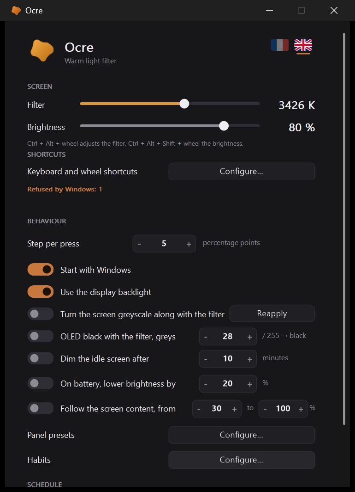
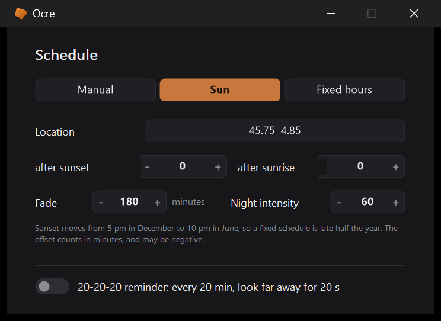

<p align="center">
  
</p>

<h1 align="center">Ocre</h1>

<p align="center"><strong>A keyboard-driven warm light filter for Windows 11.</strong></p>

<p align="center">
  <a href="https://github.com/kovarci/ocre/releases/latest"></a>
  <a href="https://github.com/kovarci/ocre/actions/workflows/ci.yml"></a>
  <a href="LICENSE"></a>
  
  
</p>

<p align="center">
  <a href="https://github.com/kovarci/ocre/releases/latest"><strong>Download</strong></a> ·
  <a href="docs/en/usage.md">Documentation</a> ·
  <a href="README.fr.md">Français</a>
</p>

<p align="center">
  
  
  
</p>

Ocre turns your screens warmer in the evening, so that they stop shouting at you at
midnight. It is driven from the keyboard, the mouse wheel, a small panel, or the
command line, and it schedules itself if you let it.

## What it does

- **Warms the colour of every screen** with a gamma ramp: instant, per screen, no
  service and no driver. Intensity in **percent or Kelvin** (1200–6500 K).
- **Driven from where your hands are**: `Ctrl+F5` / `F6` / `F7` (and a set with no
  function keys, for laptops that capture them), `Ctrl+Alt` + **mouse wheel**, the
  tray icon, a panel, or [the command line](docs/en/command-line.md) for a button
  box or a macro.
- **Schedules itself**: fixed hours, or following the sun for your city — from a
  built-in table of 26,700 cities, nothing sent over the network — with fades that
  last as long as you like.
- **Controls brightness too**: the real backlight on external monitors (DDC/CI) and on
  laptop panels, and the ramp below the hardware's floor.
- **Handles the awkward cases**: several screens with their own settings, **HDR**,
  **OLED true black**, grayscale, and a **darkroom** (red-only) mode.
- **Stays out of the way**: can dim the screen you no longer look at, lower brightness on
  battery, follow the content of the screen, learn your habits, and remind you of the
  20-20-20 rule. All optional.
- **Private by construction**: no network connection, no account, no telemetry. Settings
  live in a plain `ocre.ini`.
- **French and English** interface.

It does not use Windows' Night Light: on recent Windows 11 builds its setting can no
longer be driven from outside. [Here is the research](docs/en/why-not-night-light.md).

## Install

### The installer (recommended)

Download **`Ocre-<version>-setup.exe`** from the
[latest release](https://github.com/kovarci/ocre/releases/latest) and run it. It installs
Ocre like any other application: Start menu, an entry in *Settings > Apps*, and
optionally a launch at sign-in.

It asks for administrator rights **once**, to lift Windows' default clipping of gamma
ramps (one registry value, `GdiIcmGammaRange`). Before touching anything it records the
original state in `C:\Program Files\Ocre\sauvegarde\`, and uninstalling gives back exactly
what it changed — details in [Installation](docs/en/installation.md).

> **SmartScreen.** The files are not code-signed yet, so Windows may show *"Windows
> protected your PC"* on first launch: click **More info**, then **Run anyway**. See
> [SmartScreen](docs/en/installation.md#smartscreen) and the
> [code signing policy](#code-signing-policy).

### Other ways

- The portable **`Ocre-<version>.zip`** from the same page: `Ocre.exe` and `install.ps1`.
- From source: install [AutoHotkey v2](https://www.autohotkey.com/), clone the repository,
  run `Ocre.ahk`. See [Development](docs/en/development.md).

## Quick start

Ocre starts at 0 % — nothing happens until you ask. Press **`Ctrl+F6`** a few times.

| | Primary set | Fallback set |
|---|---|---|
| weaker filter | `Ctrl+F5` | `Ctrl+Alt+Backspace` |
| stronger filter | `Ctrl+F6` | `Ctrl+Alt+Enter` |
| toggle off / on | `Ctrl+F7` | `Ctrl+Alt+Space` |

Both sets are active at once and fully reconfigurable. The primary set needs the laptop's
Fn-lock in *function key* mode; the fallback set works everywhere.

| Gesture | Does |
|---|---|
| `Ctrl+Alt` + wheel | adjusts the filter continuously |
| `Ctrl+Alt+Shift` + wheel | adjusts the brightness |
| Wheel over the tray icon | adjusts the filter |
| Left click on the icon | the settings |
| Right click on the icon | the panel: both sliders and three presets |
| Middle click on the icon | filter off / on |

More in [Using Ocre](docs/en/usage.md).

## Command line

```
Ocre.exe /set 40          # intensity, 0-100  (/set +5, /set -5: relative)
Ocre.exe /kelvin 3400     # colour temperature
Ocre.exe /preset night    # reading, movie, night
Ocre.exe /get             # current state
Ocre.exe /reset           # neutral ramp, then quit
```

The full list, with exit codes, is in [Command line](docs/en/command-line.md).

## If something goes wrong

- **The screen stays warm** after a crash: run `Ocre.exe /reset` (the Start menu has a
  shortcut for it).
- **The shortcuts do not answer**, or the screen turns grey when Ocre switches off:
  [Troubleshooting](docs/en/troubleshooting.md).
- **A bug**: open *Settings > About > Copy diagnostic* (or run `Ocre.exe /diag`) and paste
  the result in a [new issue](https://github.com/kovarci/ocre/issues/new/choose). It holds
  the version, the Windows build and the screens — no personal data.

## Documentation

| | |
|---|---|
| [Using Ocre](docs/en/usage.md) | shortcuts, wheel, clicks, Kelvin |
| [Settings](docs/en/settings.md) | every setting, and why it is there |
| [The scheduler](docs/en/scheduler.md) | fixed hours, following the sun, where you are |
| [The interface](docs/en/interface.md) | the icon, the panel, the windows, the logo |
| [Command line](docs/en/command-line.md) | every command and exit code |
| [How it works](docs/en/how-it-works.md) | the ramp, every screen, brightness, HDR, the darkroom |
| [Why not Night Light](docs/en/why-not-night-light.md) | the research that ruled it out |
| [Installation](docs/en/installation.md) | the installer, rolling back, the startup task |
| [Troubleshooting](docs/en/troubleshooting.md) | stuck filter, function keys, grey screen |
| [Development](docs/en/development.md) | building, testing, project layout |

## Privacy and security

Ocre opens **no network connection**: its code makes no network call, and nothing is
collected or sent. It runs as your normal user. The installer is the only part that runs
elevated. To report a vulnerability, see [SECURITY.md](SECURITY.md).

## Code signing policy

> **Status:** the application for free code signing from the SignPath
> Foundation is pending. Until it is accepted, the published files -- 1.3.0
> included -- **are not signed**. This line will go away once it is.

Free code signing provided by [SignPath.io](https://signpath.io), certificate
by [SignPath Foundation](https://signpath.org).

**What is signed.** `Ocre.exe` (also inside the `.zip` archive) and
`Ocre-<version>-setup.exe`. The `.zip` archive itself is not a signable file.

**Where it comes from.** Only from
[`.github/workflows/release.yml`](.github/workflows/release.yml), run by
GitHub Actions from a tag of this repository, with build tools pinned to a
version and a hash ([`tools/outils-ci.ps1`](tools/outils-ci.ps1)). Nothing is
signed from a local machine. Every release published by this workflow also
attaches `SHA256SUMS.txt`.

**Who decides.**

| Role | Who |
|---|---|
| Authors (change the code without further review) | [@kovarci](https://github.com/kovarci) |
| Reviewers (review contributions from non-committers) | [@kovarci](https://github.com/kovarci) |
| Approvers (decide whether a release can be signed; each signing request is approved by hand) | [@kovarci](https://github.com/kovarci) |

**Privacy.** Ocre does not transfer any information to other networked
systems: its code opens no connection. The city table (GeoNames) and the font
(Inter) are embedded in the executable; the only files Ocre writes are your
settings, in `%APPDATA%\Ocre`. The installer opens no connection either. No
third-party service is involved, so no third-party privacy policy applies.

**Checking a signature.** File properties > *Digital Signatures*, or:

```powershell
Get-AuthenticodeSignature .\Ocre-1.3.0-setup.exe | Format-List
```

## Contributing

Bug reports, fixes, translations and tests are welcome — French or English. Start with
[CONTRIBUTING.md](CONTRIBUTING.md); please follow the [Code of Conduct](CODE_OF_CONDUCT.md).
The history of changes is in [CHANGELOG.md](CHANGELOG.md).

## Credits

The Night Light binary format was documented by two repositories, without which the
research in [Why not Night Light](docs/en/why-not-night-light.md) would have been
impossible:

- [**kvnxiao/win-nightlight-cli**](https://github.com/kvnxiao/win-nightlight-cli) —
  [registry structure](https://github.com/kvnxiao/win-nightlight-cli/blob/main/docs/nightlight-registry-format.md)
  and [Bond CompactBinary v1 wire format](https://github.com/kvnxiao/win-nightlight-cli/blob/main/docs/bond-compact-binary-v1.md)
- [**Enyium/sem-reg-rs**](https://github.com/Enyium/sem-reg-rs) —
  [complementary documentation](https://github.com/Enyium/sem-reg-rs/blob/master/src/cloud_store/night_light/docs.md),
  the only one to document the "adjustment in progress" flag and the
  increasing-timestamp rule

See also [elModo7/WindowsNightLight_CLI](https://github.com/elModo7/WindowsNightLight_CLI)
and [Fleex's Lab on CloudStore](https://fleexlab.blogspot.com/2017/05/the-windows-cloudstore.html).

Three things embedded in the executable come from elsewhere:

- the city table (`lib/villes.txt`) is extracted from
  [**GeoNames**](https://www.geonames.org/), licensed under
  [CC BY 4.0](https://creativecommons.org/licenses/by/4.0/);
- the badge font is [**Inter**](https://rsms.me/inter/) by Rasmus Andersson, under the
  [SIL Open Font License 1.1](lib/Inter-LICENSE.txt);
- the [**AutoHotkey v2**](https://www.autohotkey.com/) interpreter, which the Ahk2Exe
  compiler places inside `Ocre.exe` so that the script runs on its own, under the
  [GNU GPL v2](lib/AutoHotkey-LICENSE.txt). Its source is at
  [github.com/AutoHotkey/AutoHotkey](https://github.com/AutoHotkey/AutoHotkey); the
  version embedded in a build is the one `Ocre.exe /diag` prints on its *AutoHotkey* line,
  and official builds use the one pinned, with its hash, in
  [`tools/outils-ci.ps1`](tools/outils-ci.ps1). Ocre's own script stays under the MIT
  licence, which is GPL-compatible.

## Licence

MIT — see [LICENSE](LICENSE).
