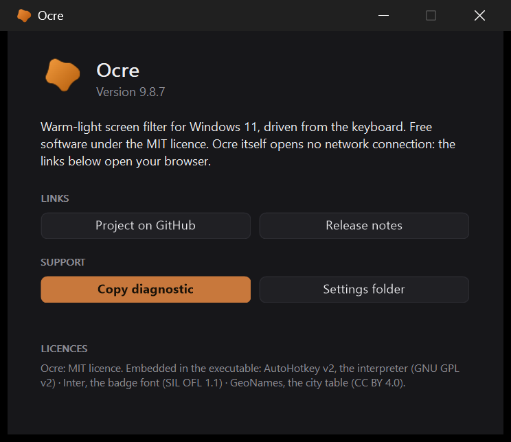

# The interface and the logo

[← Ocre](../../README.md#documentation) · [Français](../fr/interface.md)

  

## The interface

Every control — slider, toggle, counter, buttons, shortcut fields, flags —
is **drawn in GDI+** on `Picture` controls ([`lib/Ui.ahk`](../../lib/Ui.ahk),
[`lib/Widgets.ahk`](../../lib/Widgets.ahk)). This is not vanity: in a dark window,
the Windows slider and checkboxes impose their system blue, the numeric field
stays white, and the native `Hotkey` control accepts neither a `Background`
option nor `SetWindowTheme`. Drawing them is the only way to hold a palette.

The right click does not open a Windows menu but a panel of our own
([`lib/Panneau.ahk`](../../lib/Panneau.ahk)): the row height, font, margins and
corners of a system menu are not negotiable, and the result clashed next to
a fully painted window. The panel carries the intensity slider as a bonus,
which a menu could not. It closes on losing focus, like a menu — AutoHotkey
exposing no deactivation event, a timer watches the active window.

Two precautions govern this drawing:

- A `Gui` scales its coordinates by the display factor. An image painted at
  the requested size would be stretched: we therefore query the control's
  **real** size and paint at that resolution.
- Hover does not exist on a `Picture`. A single timer reads the mouse
  position and repaints the zones concerned.

Nor does the keyboard: a `Picture` receives no keys. The arrows, `Tab`,
`Home`, `End` and `Escape` go through hotkeys conditioned on the active
window (`HotIfWinActive`), which live only while ours has the focus and take
nothing from anyone else. The ring marking the focused slider appears only at
the first key, as Windows does: with the mouse, nobody needs to know which
of the two would answer the arrows.

The settings window can be dragged by its edges like any other, while its
content is painted at fixed coordinates. The two do not contradict each
other: the content lives in a child window (`WS_CHILD`) carried by a
resizable frame ([`lib/Cadre.ahk`](../../lib/Cadre.ahk)). Wider, the frame centres
the content, as Windows Settings centres its column; shorter, it scrolls it
with a scrollbar — wheel, arrows, thumb — as a browser scrolls a page.
Nothing is stretched: a 276-point slider stays a 276-point slider. On first
opening the window takes the content's height, bounded by the screen; after
that it keeps the size it was given (`taille_reglages` in `ocre.ini`). The
four other windows — scheduler, shortcuts, presets, location — ride the
same frame, each with its own key. The
window's keys — arrows, Tab, Escape — are conditioned on the frame, which
is the active window; it is the only place where the child shows.

The shortcut fields read the key with an `InputHook`, which allows assigning
the Windows key — which the native control refuses. `InputHook` prefixes
its modifiers with `<` or `>` to distinguish left from right; these prefixes
have no meaning in a shortcut definition and are stripped.

The texts live in [`lib/I18n.ahk`](../../lib/I18n.ahk), **encoded in UTF-8 with
BOM**: without it AutoHotkey would read the accents as ANSI. The other files
stay pure ASCII.

## The logo

An organic blob defined by nine polar radii smoothed by a closed curve. Its
colour follows the filter's intensity: bluish grey when the filter is off,
amber at mid-range, burnt ochre at full.

The same radius table serves on both sides: [`lib/Blob.ahk`](../../lib/Blob.ahk)
draws it live for the notification area, the badge and the window;
[`tools/make-icon.ps1`](../../tools/make-icon.ps1) draws it in System.Drawing to
produce `Ocre.ico`, the executable's icon.

An icon or bitmap handed to AutoHotkey as `HICON:*` or `HBITMAP:*` — with
the asterisk — makes it take a **copy**; the original stays ours, to be
destroyed. We long believed the opposite, and every redraw of the icon,
every hover over a button left three GDI objects and one USER object
behind: two and a half thousand more per day of wheel, and Windows kills a
process at ten thousand. `test-fuites` saw it the day it was written.
`Blob.Poser`, `Blob.Tray` and `Dessin.Poser` have done things in order since:
set, then destroy.

In the notification area, a small light disc in the blob's corner says the
schedule is paused by a manual setting — a state the colour cannot show,
and one you should not have to hover the icon to learn. It goes away at the
next transition, or through *Resume the schedule* in the panel.

The `.ico` mixes two formats on purpose: uncompressed DIB up to 64 px, PNG
beyond. `System.Drawing` refuses to read back PNG entries below 256 px, and
some resource tools do too.

### The taskbar button

It keeps the exe's orange, and that is not an oversight. Setting the tinted
icon on the window (`WM_SETICON`) changes nothing: measured on Windows 11,
the taskbar ignores it, at 32 as at 256 px, class icon included. The only
route that works — the window's `RelaunchIconResource` property, with an
`.ico` on disk — is only read when the button is created, and making it
re-read live means either blinking the window or changing the application
ID, which sends the button to the end of the bar. A steady button beats a
jumping one.
