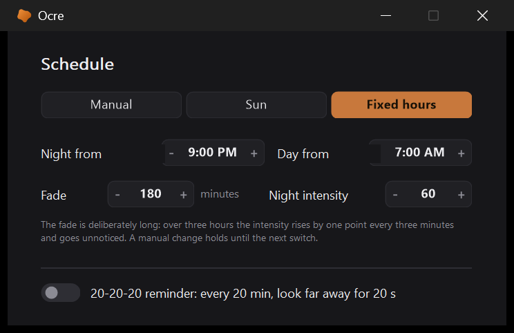
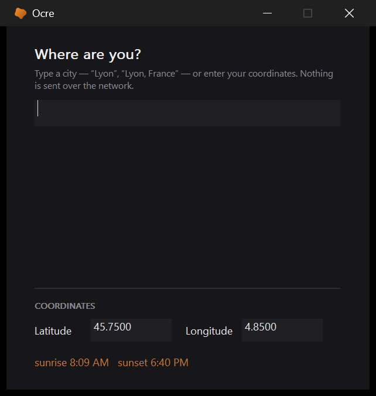

# The scheduler

[← Ocre](../../README.md#documentation) · [Français](../fr/scheduler.md)

  

Two moments in the day: the one where the rise toward the night intensity
begins, the one where the descent toward the day intensity begins. Between
the two, nothing moves.

The fade is deliberately long -- three hours by default, where tools of this
kind offer twenty seconds or an hour. At that length the intensity rises by
one point every three minutes: the eye follows without ever noticing, and
that is the whole point. A short fade is noticed, and that is precisely what
these tools are criticised for.

It is **off by default**. Setting your filter by hand is a perfectly
legitimate preference, and a program that moves on its own the first evening
gets uninstalled the next day.

A manual adjustment during a fade suspends the scheduler until the next
switch: otherwise the chosen value would be overridden three minutes later,
which feels like a program fighting its user.

The suspension is visible: the icon's tooltip says "schedule paused until
07:00", and the right-click panel then carries a *Resume the schedule* line
that sets the intensity of the hour without waiting. A scheduler that goes
quiet without saying so looks like a broken scheduler.

The day intensity has no control in the window: it is zero, that is, filter
off, in about every case where one wants a schedule. Whoever insists on a
touch of filter in broad daylight sets `h_jour` in `ocre.ini`.

## Following the sun

A fixed schedule drifts, and that was the only serious flaw of the scheduler
as it was. In Paris the sun sets at **17:00 in December and 21:55 in June**:
a rise pinned at 21:00 all year is four hours late half the time. The
three-hour fade then loses the anchor that justifies it -- it drifts by more
than its own length.

The *Sun* mode, at the top of the scheduler window -- next to *Manual* and
*Fixed hours* -- replaces the two times by two offsets: so many minutes
after sunset, so many after sunrise. Zero by default, negative to start
earlier. The three modes used to be spread between a toggle here and one
there, and you needed both to know where you stood; the *Follow a schedule*
toggle of the main window stays, and follows -- it means "not manual".

The calculation is NOAA's, in [`lib/Soleil.ahk`](../../lib/Soleil.ahk). It only
needs the date and a point on the globe: **no network, no service, nothing to
keep up to date**. The zenith used is 90.833 degrees -- the 90 geometric
degrees plus 0.833 for atmospheric refraction and the disc's half-diameter,
which is the convention for official sunrise and sunset.

It runs in two passes. The first takes the sun's position at 0 h UTC, which
is enough at our latitudes. Higher up, the sun skims the horizon: it takes an
hour to cross it where it takes ten minutes in Paris, and the declination at
midnight is no longer that of sunset. Measured against an independent
implementation: **4 minutes of error at Tromso and Reykjavik in September,
brought down to one by the second pass**, which recomputes the position at
the time found by the first.

[`tools/test-soleil.ahk`](../../tools/test-soleil.ahk) checks eighteen cases
against values produced by the Python library *astral*, which implements the
same algorithm from the original publication: comparing one transcription to
another is what catches copying mistakes. Seven places, chosen for their
traps -- southern hemisphere, equator, negative longitudes, and Tromso where
the sun neither rises nor sets at the solstices. Everything falls within two
minutes, from Ushuaia to Tromso.

Beyond the polar circles, there is sometimes neither sunrise nor sunset. The
fixed times then take over: they do not mean much there either, but they do
not leave the scheduler without bearings.

## Where you are

The calculation wants a latitude and a longitude, which nobody knows by
heart. The location window therefore accepts a city name -- "Lyon", "Lyon,
France", "Lyon, FR" -- or the coordinates directly.

The table is embedded: **26,700 cities above 20,000 inhabitants**, from
GeoNames, sorted by decreasing population -- that sort IS the ranking of the
results; typing "par" must give Paris before Paranagua. Nothing goes over the
network, neither at installation nor in use.

Two format details cost a lot and deserve to be said.

**Escaping.** The table was first a literal in `Villes.ahk`. AutoHotkey
processes the escape sequences of a continuation section character by
character: on 700 KB, that added **1.1 seconds to startup**, timed with a
stopwatch over five launches -- for an application that initialises in
0.35 s and already fights the Windows startup queue. The backtick option
disabled them, and the same file then cost only **33 ms**.

**Then nothing at all.** Thirty-three milliseconds at every startup for a
window opened once was still thirty-three too many. The table now lives in
[`lib/villes.txt`](../../lib/villes.txt), one record per line, and is only read at
the first search: a file next to the script when interpreted, a resource of
the exe once compiled -- the same mechanism as the badge's font. Startup no
longer sees it.

The table is pure ASCII, names included, like every file in the project but
two: it is the input that is flattened to ASCII before comparison, not the
other way round. "Geneve" with or without accents finds the same city, and a
German input is tried in both its forms -- GeoNames transliterates Koln as
`Koeln` and Dusseldorf as `Duesseldorf`, where ordinary flattening gives
`Koln` and `Dusseldorf`.

Exonyms remain: GeoNames calls Geneve "Geneva", Seville "Sevilla", Cologne
"Koeln". The `alternatenames` field was tried to automate this table -- it is
sorted alphabetically and mixes airport codes with transliterations from
every language: for Geneva it gives `GVA`, `Cenevre` and `Genava`, never the
French name. The list is therefore written by hand, and each entry checked
against the table.

The window permanently shows **today's sunrise and sunset** for the chosen
place. That is not decoration: there is a Laval in Quebec and a Laval in
Mayenne, and the only way to know you picked the wrong one is to see the sun
set there six hours too early.

Without a location entered, the solar mode is not mute for all that: the
Windows **time zone** -- "Romance Standard Time" for France -- gives one city
per zone ([`lib/Fuseau.ahk`](../../lib/Fuseau.ahk)), and the sun is right to within
a few minutes across a whole band of longitude, which a three-hour fade does
not distinguish. The location window says so, "Paris (from the time zone)":
it is a default, not a choice, and an entered location replaces it. The test
checks that every city of that table exists in the cities table -- it is what
caught "New York", which GeoNames calls "New York City".

Regenerating the table: [`tools/make-villes.ps1`](../../tools/make-villes.ps1).
