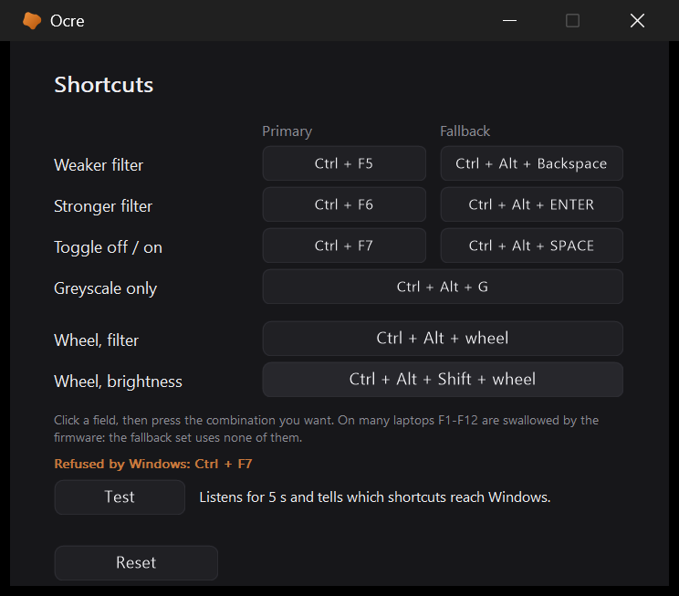
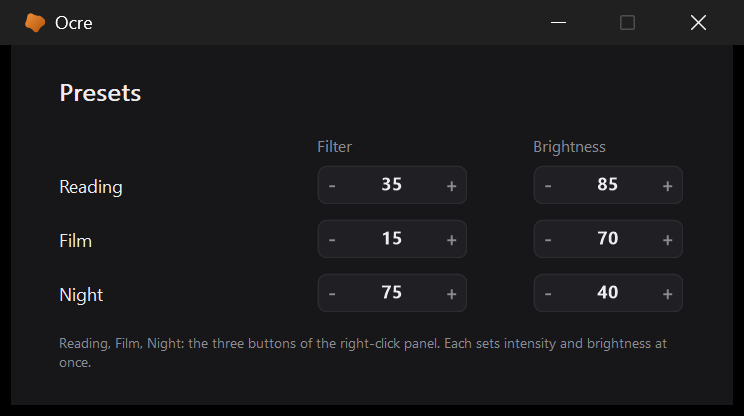
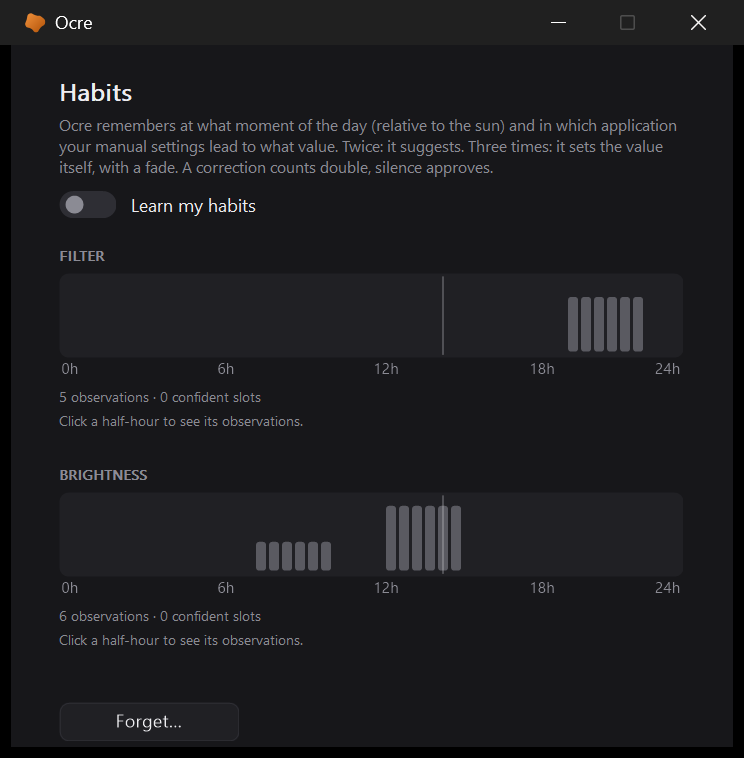

# Settings

[← Ocre](../../README.md#documentation) · [Français](../fr/settings.md)

   

Left click on the icon. There you find intensity and brightness with live
preview, the step per press, automatic startup, the hardware backlight, grey
coupled to the filter, the language choice, and *Configure...* buttons to
the shortcuts, presets, habits and scheduler windows.

**No Save button, no Close button** -- neither here nor in the secondary
windows. As in Windows Settings, every control applies the instant you
touch it: a toggle, a counter, a captured shortcut, a chosen city, it is
done, and `ocre.ini` is written two hundred milliseconds later. The window
closes with its cross or Escape. You lose "close without keeping"; you gain
never losing a setting, and two buttons per window. What touches the whole
file -- *Reset...*, *Export...*, *Import...*, *Forget...* -- keeps a
button: those are gestures you want explicit.

On first launch the
language is Windows': French if the interface is French, English for
everything else; the flag makes the next choice. In English, times read
"9:00 PM" wherever they are shown -- the tooltip, the scheduler, the
location -- and `ocre.ini` accepts that spelling too (`h_debut=9:00 PM`);
what Ocre writes there stays 24-hour. The screens section only
appears on a machine that has several. Bottom left, *Reset...* returns
`ocre.ini` to its original values after confirmation; automatic startup,
being Windows state, is left alone. Next to it, *Export...* and *Import...*
copy `ocre.ini` both ways, through the Windows dialogs: everything lives in
that file -- shortcuts, location, presets, language -- and a copy carries it
to another machine. An imported file is authoritative, even over what was
not yet written; a file without an `[ocre]` section is refused.

On first launch, two badges say the basic gesture and where the settings
are -- Ocre starts at 0 % and nothing would happen otherwise. Once, and
never again. The version number shows in two places only, where you go
looking for it: the icon's tooltip, and the **About** window (see below).

## About

The *About...* button, bottom right of the settings, opens a small window: the\nversion, links to the project and to its releases, the licences of what is\nembedded in the executable, and **Copy diagnostic**. That button puts on the\nclipboard what `Ocre.exe /diag` prints -- Ocre and Windows versions, the screens,\nwhether the gamma safeguard is lifted, whether another colour tool is running,\nthe state of the settings that matter. It holds no user name and no personal\ndata, and it is what a [bug report](https://github.com/kovarci/ocre/issues/new/choose)\nasks for. *Settings folder* opens `%APPDATA%\Ocre`, where `ocre.ini` and\n`erreurs.log` live. Ocre itself opens no connection: the two links open your\nbrowser, on your click.

## The shortcuts

They have their own window: six fields for the filter, one for greyscale
only, and the two **wheels**, whose modifiers are picked among eight
combinations -- capturing modifiers alone cannot be done cleanly. Two
hundred points of height the main window no longer had: with the alert
banner and two screens, it overflowed under the taskbar at 150 %.

A shortcut Windows refuses -- some combinations are taken by the graphics
driver or reserved -- is named under the fields, *Refused by Windows: Ctrl +
F7*, and noted in `erreurs.log`; the main window gives the count without
opening. A shortcut you believe in place that does not answer would look
like a broken program.

The **Test** button answers the other question, the one Windows cannot ask:
do the keys even arrive? Five seconds of keyboard hook, the program's own
shortcuts suspended for the trial, and the line says which were received and
which never arrived -- the case of `F5` to `F7` on a laptop whose Fn-lock is
in multimedia mode, which only `tools/sonde-touches.ahk` could tell so far.

## When a Windows filter adds up

A **red banner** under the header warns if the Windows Night Light is
scheduled or if its colour filter is on: the first would warm the screen a
second time come evening, the second would leave it grey as soon as Ocre
switches off. Both are read from the registry
([`lib/Concurrents.ahk`](../../lib/Concurrents.ahk)), without changing anything.
It also warns if **f.lux, Iris, LightBulb or Twinkle Tray** are running: two
programs writing the same ramp fight, and that is the most likely conflict
for someone trying Ocre while keeping the old one.

Why "scheduled" and not "on": on 25H2 the Night Light state key is no
longer rewritten (see the table above); only the settings key, and its
schedule flag, is kept up to date by Settings. A Night Light switched on by
hand without a schedule therefore goes under the radar -- that is the price
of not crying wolf.

The scheduler has **its own window**, opened by *Configure...*. This is not a
tidying whim: with the solar mode, the location and the two offsets, the main
window reached 1244 pixels on a 1200-pixel screen at 150 % scaling, and no
longer fitted. It was the right candidate to move out -- a schedule is set
once and not touched again, while intensity and shortcuts get revisited. The
*Follow a schedule* toggle stays in the main window, where it is seen at a
glance.

For a simple intensity change, the right click is enough: the panel carries
both sliders and **three presets** -- Reading, Film, Night. A row of three
buttons rather than three full rows: the panel must fit above the
notification area. Their values are set in a window of their own, *Panel
presets > Configure...*, modelled on the scheduler's: three rows of counters
would not have fitted in the main window, which has no height left to give.
Each click on a counter sets its row's pair on the screen, with no badge:
3,400 K is not something you choose blind. And what you see when you close
stays, like everything else in the settings -- no Apply, no going back: the
last pair you tried is the one you keep, and it counts as a manual setting
(the schedule pauses, habits take note).

The panel also carries the *On-screen badge* line, ticked by default:
unticking it silences the badge that accompanies every gesture -- shortcut,
wheel, preset. It lives only there, and in `ocre.ini` (`pastille=0`): like
the unit, it is a taste you pick once. The two welcome badges of the first
launch still show: they do not answer a gesture, they say where the door is.

## The screen you no longer look at

*Dim the idle screen after N minutes*: with no keyboard or mouse for that
long, brightness goes down to the floor -- in a three-second fade, slower
still than the `Ctrl+F7` toggle, so the screen never "drops" before the eyes
of someone who just looked up -- and comes back the same way at the first
gesture, to the previous value. A full-screen film moves neither keyboard nor
mouse for two hours: when the active window covers its whole screen, no
dimming. Off by default, like everything that moves on its own
([`lib/Inactif.ahk`](../../lib/Inactif.ahk)).

## On battery

*On battery, lower brightness by N %*: when the charger is unplugged, Ocre's
brightness -- backlight then ramp, like the slider -- goes down N points
over three seconds, and back up when it is plugged in again. A setting made
by hand in between is adopted: only what Ocre lowered itself is raised.
Windows has its own backlight setting in the power options; this one acts
on Ocre's brightness and combines with the rest. The power change arrives
through `WM_POWERBROADCAST`, already listened to for sleep; a session opened
on battery starts lowered. The row only exists on a machine that has a
battery, and the setting is off by default
([`lib/Batterie.ahk`](../../lib/Batterie.ahk)).

## Following the screen content

*Follow the screen content, from 30 to 100 %*: this is Gammy's idea. A
white page at 100 % backlight dazzles, a dark film at 40 % cannot be seen;
rather than adjusting brightness at every window change, Ocre looks at what
the screen shows and lowers brightness when the content is light, raises it
when it is dark, between the two bounds. Black content: the upper bound; a
white page: the lower bound; mid grey: the middle.

The measurement comes from **DXGI desktop duplication**
([`lib/Capture.ahk`](../../lib/Capture.ahk)), the one Gammy and capture tools use:
the graphics card hands over a texture of the desktop, we copy it into a
texture of our own with a mipmap chain, the card generates the chain --
each level is the average of the previous one -- and we only read back the
level thirty points wide, whose luminance (Rec. 601) is averaged. A true
average of the whole screen, not a sample, for two milliseconds of
processor when the image changed, and nothing at all when it did not:
`AcquireNextFrame` says so without handing anything over. Seven
measurements a second. If duplication is unavailable -- a remote session, a
machine without Direct3D -- a GDI copy takes over, dearer, one time in
three. Neither copy contains the ramp or the backlight: we measure the
content, not what we do with it, and nothing loops.

Between the measurement and the screen, two dampers: a short running
average (six tenths of the new measurement -- a changing page is followed
in three measurements, half a second) and a minimum step of two points.
The move is a six-tenths-of-a-second fade, restarted from the current value
at every new target: while the content is still changing, brightness
follows without ever jumping. A white page opening is followed within two
tenths of a second and reached in under one. An all-black screen -- an
exclusive full-screen game the duplication cannot see -- says nothing, and
the previous value is kept. Three `ocre.ini` keys with no control in the
settings, for whoever wants to tune the nervousness: `adapt_periode` (ms
between measurements, 150), `adapt_fondu` (ms of the move, 600),
`adapt_lissage` (share of the new measurement, 0.6).

DXGI duplication through the COM function tables, by hand, laid four traps,
all commented in the module: `DllCall` unloads `d3d11.dll` after the call if
nobody holds it, and the Direct3D objects then point into thin air; the very
first frame of a duplication is not one -- a restricted surface, in half
floats, with no content, which must not be used as the model for the
readback texture; `CopyResource` wants the same number of levels on both
sides; an `HRESULT` comes back signed on 32 bits and compares unsigned.

When this is on, it holds the brightness slider: the bounds are the
setting. It stays quiet while a window with a slider is open -- we do not
fight the hand holding it --, while the screen is dimmed for inactivity, and
takes off what the battery took off. With separate screens, each follows
its own content; together, the screen you are looking at decides for all.
Off by default ([`lib/Adaptatif.ahk`](../../lib/Adaptatif.ahk)).

## Learning habits

*Habits > Configure... > Learn my habits*: someone who raises brightness
every evening after sunset, or lowers the filter as soon as a film goes
full screen, does it by hand dozens of times before thinking of a schedule.
Ocre watches those gestures, remembers in which circumstances they lead to
what value, and once a circumstance has been confirmed enough times, sets
the value itself, with a fade and a badge saying "Habit · 5 times" -- then
keeps learning. It is a small model ([`lib/Habitudes.ahk`](../../lib/Habitudes.ahk)),
and every piece has a reason:

- **Settling.** A gesture is not an observation. Showing the tool to a
  friend and cranking the filter up and down like mad for five minutes is
  fifty gestures and zero choices. Only the value where the hand *stops*
  counts: two minutes without a new gesture, and that one, once.
- **The median, not the mean.** The evening of the demo, the filter stayed
  at 100 %: a mean would be pulled twenty points for weeks; a median does
  not move while a minority says otherwise.
- **Solar time.** An evening habit is "one hour after sunset", not "9 pm":
  in December the sun sets at 5 pm and a clock habit would come four hours
  late, and the clock change would shift everything at once. Around sunset
  and sunrise, gestures are compared in minutes relative to the sun (the
  settings' location, or the time zone's); in the middle of the day and
  night, by the clock.
- **The kernel.** No grid: two gestures are the more alike the closer they
  are, a Gaussian with a twenty-five-minute standard deviation. 9:29 pm
  and 9:31 pm are the same gesture; 9 pm and 10 pm have almost nothing to
  say to each other.
- **Forgetting, at two speeds.** An observation loses half its weight every
  thirty days and vanishes at sixty: winter does not dictate summer. But a
  slow memory is slow to admit a change: the four most recent observations
  form a short memory, and if they agree among themselves and disagree with
  the long one, a habit has changed -- the short one wins, in three
  evenings, without the long one losing its robustness to outliers.
- **Confidence, and suggestion.** We only act when the observations'
  weight reaches 2.5 -- three recent gestures at the right moment -- AND
  they agree: six tenths of the weight within ten points of the median.
  Sometimes 30, sometimes 80 is not a habit, it is hesitation, and we stay
  quiet. Below confidence but from two concordant evenings, Ocre
  *suggests*: a badge "80 like yesterday?" that a click accepts, which then
  counts as a gesture; ignoring it costs nothing.
- **Correction, and approval.** A gesture within ten minutes of an
  automatic set is a disavowal: the observation counts double. Thirty
  minutes without a gesture, *with someone in front of the screen* -- a set
  nobody saw says nothing --, is an approval: the value set becomes an
  implicit observation at half weight. Without it, the model killed the
  very habits it managed to automate: no more gesture, no more observation,
  and forgetting did the rest.
- **Residuals.** When an automaton holds the channel -- the scheduler for
  intensity, content following for brightness --, we learn not the value
  but the *offset* from what the automaton gave: "at this hour, always
  fifteen above the sun". The learned offset becomes a shift the automaton
  applies itself: it stays in charge, the habit corrects it. Idle dimming
  and the battery cut, though, are passing states: nothing is learned or
  set there.
- **Restraint.** Nothing in the quarter hour after a gesture, nothing while
  a gesture settles, nothing while the target has not moved since the last
  gesture -- a correction suspends the habit, as a manual setting suspends
  the scheduler, and never past the day.
- **Context.** Each observation remembers the foreground application (its
  process name, in `habitudes.ini`, locally) and whether it is full screen:
  "when the video player is full screen, brightness 40" holds at any hour.
  A context with enough observations of its own, in agreement, overrides
  the time while it is in front, and the badge names it. Weekends are a
  context too: when a moment has enough observations of the same kind of
  day, it listens only to those.
- **The ramp.** Between two confident moments at different values -- 80 at
  9 pm, 60 at 11 pm -- the value glides from one to the other instead of
  stepping, as the sun scheduler does; ramp steps show no badge.

The window shows the two curves of the day, one bar per half-hour: the
expected value as height, ochre when the model is confident, grey when it
has observations but not enough, a line at the current time, and the count
of observations and confident slots; a click on a bar lists the half-hour's
observations -- date, value, application, offset, correction or approval --
and *Forget...* clears everything. Observations live in `habitudes.ini`
next to `ocre.ini`, one line per observation, readable and editable by
hand; every observation, set, suggestion, approval and offset is written to
`habitudes.log`, to understand afterwards. The model's clock, sun, presence
and foreground application are injectable: the tests make it live two
months -- demo, correction, hesitation, approval without a witness, a
sunrise that moves, a full-screen film, a scheduler to correct -- in a few
milliseconds. Off by default.

## The 20-20-20 rule

Every twenty minutes, look twenty feet away for twenty seconds: it is the
one thing a filter does not do for your eyes. A toggle in the scheduler
window -- it is a matter of time, and the main window is full -- enables it,
off by default like everything that interrupts.

The reminder shows nothing: **the notification-area icon breathes**, the
blob shrinking and growing gently, one cycle every three seconds, for
twenty seconds. Whoever knows what it is sees it; whoever does not sees
nothing. A badge in the middle of the screen was seen by everyone --
including the person you are showing something to. For the same reason,
**filter off, no reminder**: `Ctrl+F7` is the gesture you make to show your
screen, and that is not the moment. If keyboard and mouse have been idle
for more than five minutes, it also stays quiet: the eyes are already
resting. The period is set in `ocre.ini` (`rappel_minutes`).

## Easing changes

The scheduler has its three-hour fade, whose whole point is not to be seen. A
press on a shortcut, on the other hand, jumped from one notch to the next:
five points of intensity at once is a blink. The same argument holds at both
scales, and here it only costs a sixth of a second.

The toggle (Ctrl+F7) and the presets do not take a five-point step: they go
from zero to a hundred at once, and the same sixth of a second turns that
into a flash. They therefore have their own duration, one second by default,
adjustable through the `fondu_bascule` key of `ocre.ini` (in milliseconds).
Whoever prefers the original hard cut puts it back to `160`. Grey, when
coupled to the filter, follows the same fade: it settles in and withdraws
with the tint instead of dropping at once.

What does **not** go through this fade, on purpose: the wheel and the
sliders, which are already continuous -- the gesture IS the fade, and adding
an interpolation would make the image drag behind the hand; and the write at
startup, a session that opens by brightening for a second looking like a
defect.
