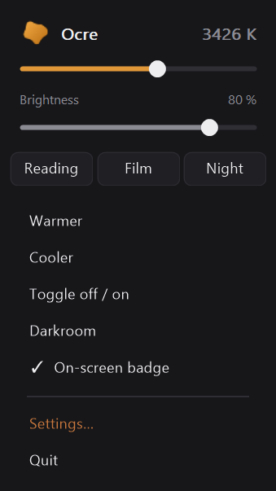

# Using Ocre

[← Ocre](../../README.md#documentation) · [Français](../fr/usage.md)

 

A keyboard-driven warm light filter for Windows 11.

| | Primary set | Fallback set |
|---|---|---|
| weaker filter | `Ctrl+F5` | `Ctrl+Alt+Backspace` |
| stronger filter | `Ctrl+F6` | `Ctrl+Alt+Enter` |
| toggle off / on | `Ctrl+F7` | `Ctrl+Alt+Space` |

Both sets are active at the same time and fully reconfigurable. The primary
set requires the laptop's Fn-lock to be in *function key* mode (see below);
the fallback set uses no function key and works everywhere.

`Ctrl+Alt` + **mouse wheel** adjusts the intensity continuously: a setting
like this is found rather than typed, and no key gives that kind of
progression. The same wheel with **`Shift`** added adjusts the brightness.
And the wheel **over the icon** next to the clock, with nothing else, adjusts
the intensity too.

A **left click** on the icon opens the settings; a **right click** opens a
small panel where intensity, brightness and three presets are within reach
without opening anything; a **middle click** turns the filter off or back on
-- Ctrl+F7 for whoever has a hand on the mouse. The interface is in French
and English.

Intensity is shown in **percent or Kelvin** -- 3400 K means something to
anyone coming from f.lux or Night Light, 58 % means nothing. A click on the
value at the top of the right-click panel switches between the two; it is the
only place where this is chosen. Only the display changes: the slider, the
shortcuts and the configuration file still count in percent.

Inside the windows, the **arrow keys** adjust the focused slider, `Tab` moves
to the next one, `Home` and `End` go to the ends, `Escape` closes.

Everything can also be driven from the command line -- `Ocre.exe /set 40`,
`/kelvin 3400`, `/preset night`, `/get` -- for a button box or a macro.
