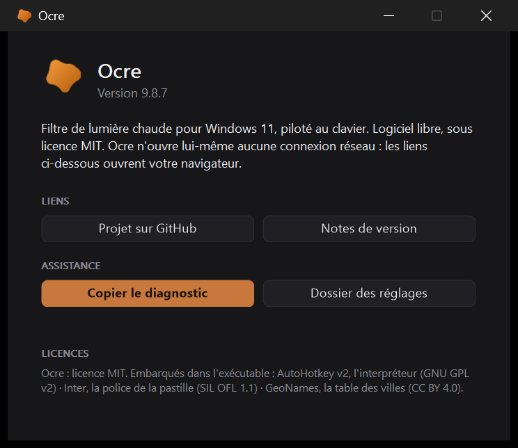

# L'interface et le logo

[← Ocre](../../README.fr.md#documentation) · [English](../en/interface.md)

  

## L'interface

Toutes les commandes -- curseur, bascules, compteur, boutons, champs de
raccourci, drapeaux -- sont **dessinees en GDI+** sur des `Picture`
([`lib/Ui.ahk`](../../lib/Ui.ahk), [`lib/Widgets.ahk`](../../lib/Widgets.ahk)). Ce n'est
pas de la coquetterie : dans une fenetre sombre, le curseur et les cases a
cocher de Windows imposent leur bleu systeme, le champ numerique reste blanc,
et le controle `Hotkey` natif n'accepte ni option `Background` ni
`SetWindowTheme`. Les dessiner est le seul moyen de tenir une palette.

Le clic droit n'ouvre pas un menu Windows mais un panneau a nous
([`lib/Panneau.ahk`](../../lib/Panneau.ahk)) : la hauteur de ligne, la police, les
marges et les coins d'un menu systeme ne sont pas negociables, et le resultat
detonnait a cote d'une fenetre entierement peinte. Le panneau porte en prime le
curseur d'intensite, ce qu'un menu ne saurait faire. Il se ferme a la perte du
focus, comme un menu -- AutoHotkey n'exposant pas d'evenement de desactivation,
un minuteur surveille la fenetre active.

Deux precautions gouvernent ce dessin :

- Un `Gui` met ses coordonnees a l'echelle du facteur d'affichage. Une image
  peinte a la taille demandee serait etiree : on interroge donc la taille
  **reelle** du controle et l'on peint a cette resolution.
- Le survol n'existe pas sur une `Picture`. Un minuteur unique releve la
  position de la souris et redessine les zones concernees.

Le clavier non plus : une `Picture` ne recoit aucune touche. Les fleches,
`Tab`, `Origine`, `Fin` et `Echap` passent par des raccourcis conditionnes a
la fenetre active (`HotIfWinActive`), qui ne vivent que tant que la notre a
le focus et ne prennent rien a personne. L'anneau qui marque le curseur vise
n'apparait qu'a la premiere touche, comme le fait Windows : a la souris,
personne n'a besoin de savoir lequel des deux repondrait aux fleches.

La fenetre des reglages se tire par ses bords comme n'importe quelle autre,
alors que son contenu est peint a coordonnees fixes. Les deux ne se
contredisent pas : le contenu vit dans une fenetre enfant (`WS_CHILD`) que
porte un cadre redimensionnable ([`lib/Cadre.ahk`](../../lib/Cadre.ahk)). Plus
large, le cadre centre le contenu, comme les reglages de Windows centrent
leur colonne ; moins haut, il le fait defiler par un ascenseur -- molette,
fleches de l'ascenseur, poignee -- comme un navigateur fait defiler une page.
Rien n'est etire : un curseur de 276 points reste un curseur de 276 points.
A la premiere ouverture, la fenetre prend la hauteur du contenu, bornee a
l'ecran ; ensuite elle garde la taille qu'on lui a donnee (`taille_reglages`
dans `ocre.ini`). Les quatre autres fenetres -- planificateur, raccourcis,
prereglages, lieu -- sont portees par le meme cadre, avec chacune sa cle. Les raccourcis de la fenetre -- fleches, Tab, Echap -- se
conditionnent sur le cadre, qui est la fenetre active ; c'est le seul endroit
ou l'enfant se voit.

Les champs de raccourci lisent la touche par un `InputHook`, ce qui permet
d'affecter la touche Windows -- que le controle natif refuse. `InputHook`
prefixe ses modificateurs de `<` ou `>` pour distinguer gauche et droite ; ces
prefixes n'ont pas de sens dans une definition de raccourci et sont retires.

Les textes vivent dans [`lib/I18n.ahk`](../../lib/I18n.ahk), **encode en UTF-8 avec
BOM** : sans lui AutoHotkey lirait les accents en ANSI. Les autres fichiers
restent en ASCII pur.

## Le logo

Une tache organique definie par neuf rayons polaires lisses par une courbe
fermee. Sa couleur suit l'intensite du filtre : gris bleute quand le filtre est
coupe, ambre a mi-course, ocre brulee a fond.

La meme table de rayons sert des deux cotes : [`lib/Blob.ahk`](../../lib/Blob.ahk)
la dessine a chaud pour la zone de notification, la pastille et la fenetre ;
[`tools/make-icon.ps1`](../../tools/make-icon.ps1) la dessine en System.Drawing pour
produire `Ocre.ico`, l'icone de l'executable.

Une icone ou un bitmap passe a AutoHotkey sous la forme `HICON:*` ou
`HBITMAP:*` -- avec l'asterisque -- lui fait prendre une **copie** ; l'original
reste a nous, et a detruire. On l'a cru longtemps l'inverse, et chaque
redessin de l'icone, chaque survol d'un bouton laissait trois objets GDI et
un objet USER derriere lui : deux mille cinq cents de plus par jour de
molette, et Windows tue un processus a dix mille. C'est `test-fuites` qui l'a
vu, le jour de son ecriture. `Blob.Poser`, `Blob.Tray` et `Dessin.Poser`
font depuis les choses dans l'ordre : poser, puis detruire.

Dans la zone de notification, un petit disque clair dans le coin de la tache
dit que l'horaire est suspendu par un reglage a la main -- un etat que la
couleur ne montre pas, et qu'on ne devrait pas avoir a survoler l'icone pour
connaitre. Il disparait au basculement suivant, ou par *Reprendre l'horaire*
dans le panneau.

Le `.ico` melange deux formats a dessein : DIB non compresse jusqu'a 64 px,
PNG au-dela. `System.Drawing` refuse de relire les entrees PNG en dessous de
256 px, et certains outils de ressources aussi.

### Le bouton de la barre des taches

Il reste a l'orange de l'exe, et ce n'est pas un oubli. Poser l'icone
teintee sur la fenetre (`WM_SETICON`) ne change rien : mesure sur Windows
11, la barre l'ignore, en 32 comme en 256 px, icone de classe comprise. La
seule voie qui marche -- la propriete `RelaunchIconResource` de la fenetre,
avec un `.ico` sur disque -- n'est lue qu'a la creation du bouton, et la
faire relire a chaud impose soit de faire clignoter la fenetre, soit de
changer l'identifiant d'application, ce qui envoie le bouton en fin de
barre. Un bouton fixe vaut mieux qu'un bouton qui saute.
