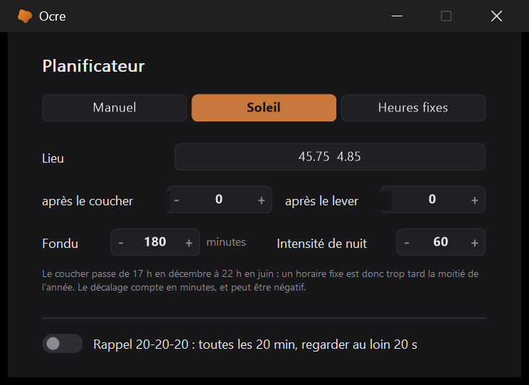
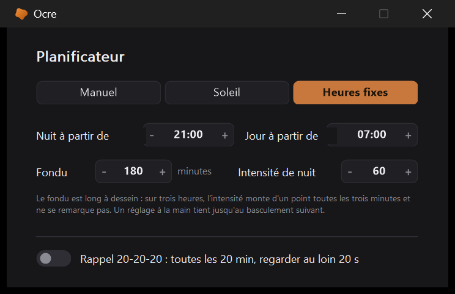
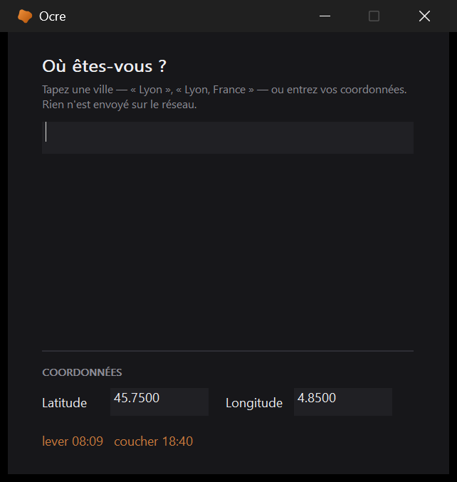

# Le planificateur

[← Ocre](../../README.fr.md#documentation) · [English](../en/scheduler.md)

  

Deux moments dans la journée : celui où la montée vers l'intensité de nuit
commence, celui où la descente vers celle de jour commence. Entre les deux,
rien ne bouge.

Le fondu est long à dessein — trois heures par défaut, là où les outils du
genre proposent vingt secondes ou une heure. À cette durée l'intensité monte
d'un point toutes les trois minutes : l'œil suit sans jamais rien remarquer,
et c'est tout l'intérêt. Un fondu court, lui, se remarque, et c'est précisément
ce qu'on reproche à ces outils.

Il est **coupé par défaut**. Régler son filtre à la main est une préférence
parfaitement légitime, et un programme qui bouge tout seul le premier soir se
fait désinstaller le lendemain.

Un réglage à la main pendant un fondu suspend le planificateur jusqu'au
basculement suivant : sans cela la valeur choisie serait reprise trois minutes
plus tard, ce qui donne l'impression d'un programme qui se bat contre son
utilisateur.

La suspension se voit : l'infobulle de l'icône dit « horaire suspendu jusqu'à
07:00 », et le panneau du clic droit porte alors une ligne *Reprendre
l'horaire* qui repose l'intensité de l'heure sans attendre. Un planificateur
qui se tait sans le dire passe pour un planificateur en panne.

L'intensité de jour n'a pas de commande dans la fenêtre : elle vaut zéro,
c'est-à-dire filtre coupé, dans à peu près tous les cas où l'on veut un
horaire. Qui tient à un fond de filtre en pleine journée pose `h_jour` dans
`ocre.ini`.

## Caler sur le soleil

Un horaire fixe dérive, et c'est le seul défaut sérieux du planificateur tel
qu'il était. À Paris le soleil se couche à **17:00 en décembre et à 21:55 en
juin** : une montée calée sur 21:00 toute l'année est quatre heures trop tard
la moitié du temps. Le fondu de trois heures perd alors l'ancrage qui le
justifie — il dérive de plus que sa propre durée.

Le mode *Soleil*, en tête de la fenêtre du planificateur — à côté de
*Manuel* et *Heures fixes* —, remplace les deux heures par deux décalages :
tant de minutes après le coucher, tant de minutes après le lever. Zéro par
défaut, négatif si l'on veut commencer avant. Les trois modes étaient
répartis entre une bascule ici et une là-bas, et il fallait les deux pour
savoir où l'on en était ; la bascule *Suivre un horaire* de la fenêtre
principale reste, et suit — elle vaut « pas manuel ».

Le calcul est celui de la NOAA, dans [`lib/Soleil.ahk`](../../lib/Soleil.ahk). Il ne
demande que la date et un point sur le globe : **pas de réseau, pas de service,
rien à tenir à jour**. Le zénith retenu est 90,833 degrés — les 90 degrés
géométriques plus 0,833 pour la réfraction atmosphérique et le demi-diamètre du
disque, ce qui est la convention du lever et du coucher officiels.

Il se fait en deux passes. La première prend la position du soleil à 0 h UTC,
ce qui suffit sous nos latitudes. Plus haut, l'astre rase l'horizon : il y
passe une heure là où il met dix minutes à Paris, et la déclinaison à minuit
n'est plus celle du coucher. Mesuré contre une implémentation indépendante :
**4 minutes d'erreur à Tromso et à Reykjavik en septembre, ramenées à une seule
par la seconde passe**, qui recalcule la position à l'heure trouvée par la
première.

[`tools/test-soleil.ahk`](../../tools/test-soleil.ahk) vérifie dix-huit cas contre
des valeurs produites par la bibliothèque Python *astral*, qui implémente le
même algorithme depuis la publication d'origine : comparer une transcription à
une autre est ce qui attrape les fautes de recopie. Sept lieux, choisis pour
les pièges — hémisphère sud, équateur, longitudes négatives, et Tromso où le
soleil ne se lève ni ne se couche aux solstices. Tout tombe à deux minutes,
d'Ushuaia à Tromso.

Au-delà des cercles polaires, il arrive qu'il n'y ait ni lever ni coucher. Les
heures fixes reprennent alors la main : elles ne veulent pas dire grand-chose
là-bas non plus, mais elles ne laissent pas le planificateur sans repères.

## Où vous êtes

Le calcul veut une latitude et une longitude, que personne ne connaît par
cœur. La fenêtre du lieu accepte donc un nom de ville — « Lyon », « Lyon,
France », « Lyon, FR » — ou les coordonnées directement.

La table est embarquée : **26 700 villes de plus de 20 000 habitants**, issues
de GeoNames, triées par population décroissante — ce tri EST le classement des
résultats, taper « par » doit donner Paris avant Paranaguá. Rien ne part sur le
réseau, ni à l'installation ni à l'usage.

Deux détails de format ont coûté cher et méritent d'être dits.

**L'échappement.** La table a d'abord été un littéral dans `Villes.ahk`.
AutoHotkey traite les séquences d'échappement d'une section de continuation
caractère par caractère : sur 700 Ko, cela ajoutait **1,1 seconde au
démarrage**, mesurée au chronomètre sur cinq lancements — pour une
application qui s'initialise en 0,35 s et se bat déjà contre la file de
démarrage de Windows. L'option accent grave les désactivait, et le même
fichier ne coûtait plus que **33 ms**.

**Puis plus rien.** Trente-trois millisecondes à chaque démarrage pour une
fenêtre qu'on ouvre une fois, c'était encore trente-trois de trop. La table
vit maintenant dans [`lib/villes.txt`](../../lib/villes.txt), un enregistrement par
ligne, et n'est lue qu'à la première recherche : un fichier à côté du script
quand on l'interprète, une ressource de l'exe une fois compilé — le même
mécanisme que la police de la pastille. Le démarrage ne la voit plus passer.

La table est en ASCII pur, noms compris, comme tous les fichiers du projet sauf
deux : c'est la saisie qui est rabattue sur l'ASCII avant comparaison, pas
l'inverse. « Genève » accentué ou non trouve la même ville, et une saisie
allemande est essayée sous ses deux formes — GeoNames translittère Köln en
`Koeln` et Düsseldorf en `Duesseldorf`, là où la mise à plat ordinaire donne
`Koln` et `Dusseldorf`.

Restent les exonymes : GeoNames nomme Genève « Geneva », Séville « Sevilla »,
Cologne « Koeln ». Le champ `alternatenames` a été essayé pour automatiser
cette table — il est trié alphabétiquement et mélange codes d'aéroport et
translittérations de toutes les langues : pour Genève il donne `GVA`, `Cenevre`
et `Genava`, jamais le nom français. La liste est donc écrite à la main, et
chaque entrée vérifiée contre la table.

La fenêtre affiche en permanence **le lever et le coucher du jour** pour le
lieu retenu. Ce n'est pas une décoration : il existe un Laval au Québec et un
Laval en Mayenne, et la seule façon de savoir qu'on a pris le mauvais est de
voir le soleil s'y coucher six heures trop tôt.

Sans lieu saisi, le mode solaire n'est pas muet pour autant : le **fuseau
horaire** de Windows — « Romance Standard Time » pour la France — donne une
ville par fuseau ([`lib/Fuseau.ahk`](../../lib/Fuseau.ahk)), et le soleil est bon à
quelques minutes près pour toute une bande de longitude, ce qu'un fondu de
trois heures ne distingue pas. La fenêtre du lieu le dit, « Paris (d'après le
fuseau horaire) » : c'est un défaut, pas un choix, et un lieu saisi le
remplace. Le test vérifie que chaque ville de cette table existe dans celle
des villes — c'est lui qui a attrapé « New York », que GeoNames nomme
« New York City ».

Régénération de la table : [`tools/make-villes.ps1`](../../tools/make-villes.ps1).
