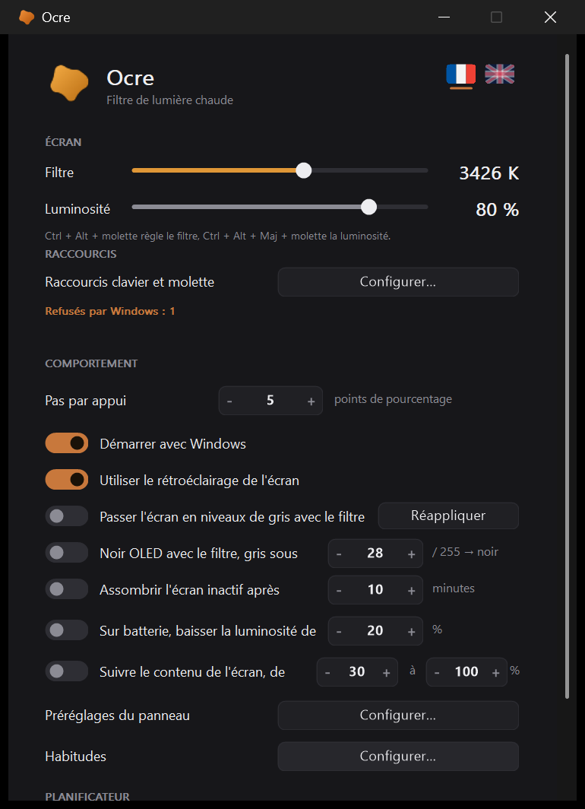
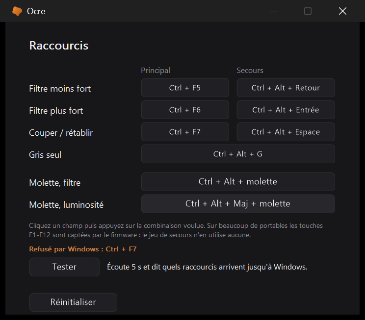
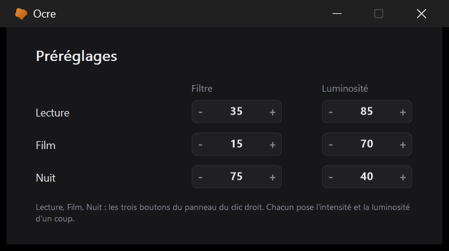
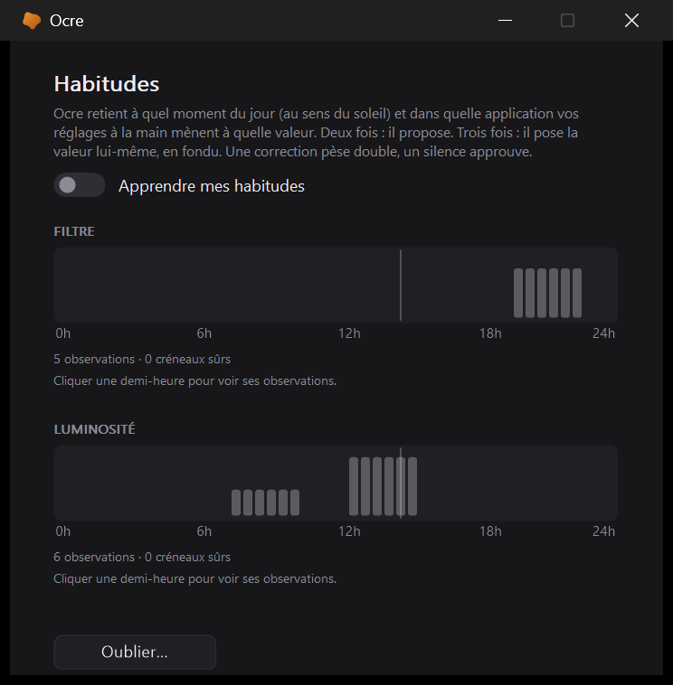

# Reglages

[← Ocre](../../README.fr.md#documentation) · [English](../en/settings.md)

   

Clic gauche sur l'icone. On y trouve l'intensite et la luminosite avec apercu
en direct, le pas par appui, le demarrage automatique, le retroeclairage
materiel, le gris couple au filtre, le choix de la langue, et des boutons
*Configurer...* vers les fenetres des raccourcis, des prereglages, des
habitudes et du planificateur.

**Pas de bouton Enregistrer, pas de bouton Fermer** -- ni ici ni dans les
fenetres secondaires. Comme dans les reglages de Windows, chaque commande
s'applique a l'instant ou on la touche : une bascule, un compteur, un
raccourci capture, une ville choisie, c'est fait, et `ocre.ini` est ecrit
deux cents millisecondes plus tard. La fenetre se ferme par sa croix ou par
Echap. On y perd le « fermer sans garder » ; on y gagne de ne jamais perdre
un reglage, et deux boutons par fenetre. Ce qui touche au fichier entier --
*Reinitialiser...*, *Exporter...*, *Importer...*, *Oublier...* -- garde un
bouton : ce sont des gestes qu'on veut explicites. Au premier lancement, la langue est celle de Windows :
francais si l'interface est en francais, anglais pour tout le reste ; le
drapeau fait le choix suivant. En anglais, les heures se lisent « 9:00 PM »
partout ou elles s'affichent -- l'infobulle, le planificateur, le lieu --,
et `ocre.ini` accepte aussi cette ecriture (`h_debut=9:00 PM`) ; ce qu'Ocre
y ecrit reste en 24 h. La section des ecrans n'apparait que sur une machine qui en a
plusieurs. En bas a gauche, *Reinitialiser...* remet `ocre.ini` a ses
valeurs d'origine, apres confirmation ; le demarrage automatique, qui est un
etat de Windows, n'est pas touche. A cote, *Exporter...* et *Importer...*
copient `ocre.ini` dans les deux sens, par les boites de dialogue de Windows :
tout tient dans ce fichier -- raccourcis, lieu, prereglages, langue -- et une
copie l'emporte sur une autre machine. Un fichier importe fait foi, meme sur
ce qui n'etait pas encore ecrit ; un fichier sans section `[ocre]` est
refuse.

Au premier lancement, deux pastilles disent le geste de base et ou sont les
reglages -- Ocre demarre a 0 % et rien ne se passerait sinon. Une fois, et
plus jamais. Le numero de version ne s'affiche qu'a deux endroits, la ou l'on
va le chercher : l'infobulle de l'icone, et la fenetre **A propos** (voir plus bas).

## A propos

Le bouton *A propos...*, en bas a droite des reglages, ouvre une petite fenetre : la\nversion, les liens du projet et de ses versions, les licences de ce qui est\nembarque dans l'executable, et **Copier le diagnostic**. Ce bouton met dans le\npresse-papiers ce qu'ecrit `Ocre.exe /diag` -- les versions d'Ocre et de Windows,\nles ecrans, si le garde-fou gamma est leve, si un autre outil de couleur tourne,\nl'etat des reglages qui comptent. Ni nom d'utilisateur ni donnee personnelle :\nc'est ce que demande un [signalement de bogue](https://github.com/kovarci/ocre/issues/new/choose).\n*Dossier des reglages* ouvre `%APPDATA%\Ocre`, ou vivent `ocre.ini` et\n`erreurs.log`. Ocre lui-meme n'ouvre aucune connexion : les deux liens ouvrent\nvotre navigateur, a votre clic.

## Les raccourcis

Ils ont leur fenetre : six champs pour le filtre, un pour le gris seul, et
les deux **molettes**, dont on choisit les modificateurs parmi huit
combinaisons -- une capture de modificateurs seuls ne se fait pas proprement.
Deux cents points de hauteur que la fenetre principale n'avait plus : avec le
bandeau d'alerte et deux ecrans, elle debordait sous la barre des taches a
150 %.

Un raccourci que Windows refuse -- certaines combinaisons sont prises par le
pilote graphique ou reservees -- est nomme sous les champs, *Refuse par
Windows : Ctrl + F7*, et note dans `erreurs.log` ; la fenetre principale en
donne le nombre sans qu'on ait a ouvrir. Un raccourci qu'on croit en place et
qui ne repond pas passerait pour un programme casse.

Le bouton **Tester** repond a l'autre question, celle que Windows ne peut pas
poser : les touches arrivent-elles seulement ? Cinq secondes d'ecoute par
crochet clavier, les raccourcis du programme suspendus le temps de l'essai,
et la ligne dit lesquels ont ete recus et lesquels ne sont jamais arrives --
c'est le cas de `F5` a `F7` sur un portable dont le Fn-lock est en mode
multimedia, et jusqu'ici seul `tools/sonde-touches.ahk` savait le dire.

## Quand un filtre de Windows se cumule

Un **bandeau rouge** sous l'en-tete previent si l'eclairage nocturne de
Windows est programme ou si son filtre de couleur est actif : le premier
rechaufferait l'ecran une seconde fois le soir venu, le second le laisserait
gris des qu'Ocre se coupe. Les deux sont lus dans le registre
([`lib/Concurrents.ahk`](../../lib/Concurrents.ahk)), sans rien modifier. Il
previent aussi si **f.lux, Iris, LightBulb ou Twinkle Tray** tournent : deux
programmes qui ecrivent la meme rampe se battent, et c'est le conflit le plus
probable chez quelqu'un qui essaie Ocre en gardant l'ancien.

Pourquoi « programme » et non « actif » : sur 25H2, la cle d'etat du Night
Light n'est plus reecrite (voir le tableau plus haut) ; seule celle des
reglages, et son drapeau d'horaire, est tenue a jour par les Parametres. Un
Night Light allume a la main sans horaire passe donc sous le radar -- c'est
le prix de ne pas crier faux.

Le planificateur a **sa propre fenetre**, ouverte par *Configurer…*. Ce n'est
pas un caprice de rangement : avec le mode solaire, le lieu et les deux
decalages, la fenetre principale atteignait 1244 pixels sur un ecran de 1200 a
150 % de mise a l'echelle, et ne tenait plus. C'etait le bon candidat au
depart -- un horaire se regle une fois et ne se retouche plus, alors que
l'intensite et les raccourcis se reprennent. La bascule *Suivre un horaire*,
elle, reste dans la fenetre principale, ou elle se voit d'un coup d'oeil.

Pour un simple changement d'intensite, le clic droit suffit : le panneau porte
les deux curseurs et **trois prereglages** -- Lecture, Film, Nuit. Une rangee
de trois boutons plutot que trois rangees pleines : le panneau doit tenir
au-dessus de la zone de notification. Leurs valeurs se reglent dans une
fenetre a part, *Prereglages du panneau > Configurer...*, sur le modele du
planificateur : trois rangees de compteurs n'auraient pas tenu dans la
fenetre principale, qui n'a plus de hauteur a donner. Chaque clic sur un
compteur pose le couple de sa rangee sur l'ecran, sans pastille : 3 400 K ne
se choisit pas a l'aveugle. Et ce qu'on voit en fermant reste, comme pour
tout le reste des reglages -- pas de Valider, pas de retour en arriere : le
dernier couple essaye est celui qu'on garde, et il compte comme un reglage a
la main (l'horaire se suspend, les habitudes le notent).

Le panneau porte aussi la ligne *Pastille a l'ecran*, cochee par defaut : la
decocher fait taire la vignette qui accompagne chaque geste -- raccourci,
molette, prereglage. Elle n'est que la, et dans `ocre.ini` (`pastille=0`) :
comme l'unite, c'est un gout qu'on choisit une fois. Les deux pastilles
d'accueil du premier lancement passent quand meme : elles ne repondent pas a
un geste, elles disent ou est la porte.

## L'ecran qu'on ne regarde plus

*Assombrir l'ecran inactif apres N minutes* : sans clavier ni souris pendant
ce temps, la luminosite descend au plancher -- en trois secondes de fondu,
plus lentement encore que la bascule de `Ctrl+F7`, pour que l'ecran ne
« tombe » jamais sous les yeux de qui vient de lever la tete -- et remonte de
la meme facon au premier geste, a la valeur d'avant. Un film en plein ecran
ne bouge ni clavier ni souris pendant deux heures : quand la fenetre active
couvre tout son ecran, on ne s'assombrit pas. Coupe par defaut, comme tout ce
qui bouge tout seul ([`lib/Inactif.ahk`](../../lib/Inactif.ahk)).

## Sur batterie

*Sur batterie, baisser la luminosite de N %* : au debranchement du chargeur,
la luminosite d'Ocre -- retroeclairage puis rampe, comme le curseur --
descend de N points en trois secondes, et remonte au rebranchement. Un
reglage fait a la main entre-temps est adopte : on ne remonte que ce qu'on a
baisse soi-meme. Windows a son propre reglage pour le retroeclairage dans
les options d'alimentation ; celui-ci porte sur la luminosite d'Ocre, et se
combine avec le reste. Le changement d'alimentation arrive par
`WM_POWERBROADCAST`, deja ecoute pour la veille ; une session ouverte sur
batterie part deja baissee. La rangee n'existe que sur une machine qui a une
batterie, et le reglage est coupe par defaut
([`lib/Batterie.ahk`](../../lib/Batterie.ahk)).

## Suivre le contenu de l'ecran

*Suivre le contenu de l'ecran, de 30 a 100 %* : c'est l'idee de Gammy. Une
page blanche a 100 % de retroeclairage eblouit, un film sombre a 40 % ne se
voit plus ; plutot que de regler la luminosite a chaque changement de
fenetre, Ocre regarde ce que l'ecran affiche et descend la luminosite quand
le contenu est clair, la remonte quand il est sombre, entre les deux bornes.
Contenu noir : la borne haute ; page blanche : la borne basse ; gris moyen :
le milieu.

La mesure vient de la **duplication de bureau DXGI**
([`lib/Capture.ahk`](../../lib/Capture.ahk)), celle de Gammy et des logiciels de
capture : la carte graphique donne une texture du bureau, on la copie dans
une texture a nous munie d'une chaine de mipmaps, la carte genere la chaine
-- chaque niveau est la moyenne du precedent -- et l'on ne relit que le
niveau de trente points de large, dont on moyenne la luminance (Rec. 601).
C'est une vraie moyenne de tout l'ecran, pas un echantillon, pour deux
millisecondes de processeur quand l'image a change, et rien du tout quand
elle n'a pas change : `AcquireNextFrame` le dit sans rien rendre. Sept
mesures par seconde. Si la duplication manque -- session distante, machine
sans Direct3D --, une copie GDI prend le relais, plus chere, une fois sur
trois. La rampe et le retroeclairage ne sont dans aucune des deux : on
mesure le contenu, pas ce qu'on en fait, et rien ne boucle.

Entre la mesure et l'ecran, deux amortisseurs : une moyenne glissante courte
(six dixiemes de la mesure neuve -- une page qui change est suivie en trois
mesures, une demi-seconde) et un pas minimal de deux points. Le mouvement
est un fondu de six dixiemes de seconde, relance depuis la valeur du moment
a chaque nouvelle cible : quand le contenu bouge encore, la luminosite le
suit sans jamais sauter. Une page blanche qui s'ouvre est suivie en deux
dixiemes de seconde et rejointe en moins d'une. Un ecran tout noir -- un jeu
en plein ecran exclusif, que la duplication ne voit pas -- ne dit rien, et
l'on garde la valeur d'avant. Trois cles d'`ocre.ini` sans commande dans
les reglages, pour qui veut regler la nervosite : `adapt_periode` (ms entre
deux mesures, 150), `adapt_fondu` (ms du mouvement, 600), `adapt_lissage`
(part de la mesure neuve, 0,6).

La duplication DXGI par les tables de fonctions COM, a la main, a couche
quatre pieges, tous commentes dans le module : `DllCall` decharge
`d3d11.dll` apres l'appel si on ne la tient pas, et les objets Direct3D
pointent alors dans le vide ; la toute premiere image d'une duplication
n'en est pas une -- une surface restreinte, en demi-flottants, sans
contenu, dont il ne faut surtout pas faire le modele de sa texture de
lecture ; `CopyResource` veut le meme nombre de niveaux des deux cotes ; un
`HRESULT` revient signe sur 32 bits et se compare non signe.

Quand ce suivi est actif, c'est lui qui tient le curseur de luminosite : les
bornes sont le reglage. Il se tait tant qu'une fenetre a curseur est ouverte
-- on ne dispute pas le curseur a la main qui le tient --, quand l'ecran est
assombri pour inactivite, et retire ce que la batterie a retire. Ecrans
separes, chaque ecran suit son propre contenu ; ensemble, c'est l'ecran
qu'on regarde qui decide pour tous. Coupe par defaut
([`lib/Adaptatif.ahk`](../../lib/Adaptatif.ahk)).

## Apprendre les habitudes

*Habitudes > Configurer... > Apprendre mes habitudes* : quelqu'un qui
remonte la luminosite tous les soirs apres le coucher du soleil, ou qui
baisse le filtre des qu'un film passe en plein ecran, le fait a la main des
dizaines de fois avant de penser a un horaire. Ocre regarde ces gestes,
retient dans quelles circonstances ils menent a quelle valeur, et quand une
circonstance a ete confirmee assez de fois, pose la valeur lui-meme, en
fondu, avec une pastille qui dit « Habitude · 5 fois » -- puis continue
d'apprendre. C'est un petit modele ([`lib/Habitudes.ahk`](../../lib/Habitudes.ahk)),
et chaque piece a une raison :

- **La decantation.** Un geste n'est pas une observation. Montrer l'outil a
  un ami et faire monter et descendre le filtre comme un fou pendant cinq
  minutes, c'est cinquante gestes et zero choix. Seule compte la valeur ou
  la main *s'arrete* : deux minutes sans nouveau geste, et c'est celle-la,
  une seule fois.
- **La mediane, pas la moyenne.** Le soir de la demonstration, le filtre est
  reste a 100 % : une moyenne en serait tiree de vingt points pendant des
  semaines ; une mediane ne bouge pas tant qu'une minorite dit autre chose.
- **Le temps solaire.** Une habitude du soir est « une heure apres le
  coucher », pas « 21 h » : en decembre le soleil se couche a 17 h et
  l'habitude horaire arriverait quatre heures trop tard, et le changement
  d'heure decalerait tout d'un coup. Autour du coucher et du lever, les
  gestes se comparent en minutes par rapport au soleil (le lieu des
  reglages, ou celui du fuseau horaire) ; au milieu du jour et de la nuit, a
  l'horloge.
- **Le noyau.** Pas de grille : deux gestes se ressemblent d'autant plus
  qu'ils sont proches, une gaussienne de vingt-cinq minutes d'ecart-type.
  21 h 29 et 21 h 31 sont le meme geste ; 21 h et 22 h n'ont presque rien a
  se dire.
- **L'oubli, a deux vitesses.** Une observation perd la moitie de son poids
  tous les trente jours et disparait a soixante : l'hiver ne dicte pas
  l'ete. Mais une memoire lente est lente a admettre un changement : les
  quatre observations les plus recentes forment une memoire courte, et si
  elles sont d'accord entre elles et en desaccord avec la longue, c'est
  qu'une habitude a change -- la courte l'emporte, en trois soirs, sans que
  la longue perde sa robustesse contre les aberrants.
- **La confiance, et la proposition.** On n'agit que si le poids des
  observations atteint 2,5 -- trois gestes recents au bon moment -- ET si
  elles sont d'accord : six dixiemes du poids a dix points ou moins de la
  mediane. Tantot 30, tantot 80, ce n'est pas une habitude, c'est une
  hesitation, et l'on se tait. En dessous de la confiance mais des deux
  soirs concordants, Ocre *propose* : une pastille « 80 comme hier ? »
  qu'un clic accepte, et qui compte alors pour un geste ; l'ignorer ne
  coute rien.
- **La correction, et l'approbation.** Un geste dans les dix minutes qui
  suivent une pose automatique est un desaveu : l'observation pese double.
  Trente minutes sans geste, *avec quelqu'un devant l'ecran* -- une pose
  que personne n'a vue ne dit rien --, c'est une approbation : la valeur
  posee devient une observation implicite a demi-poids. Sans cela, le
  modele tuait les habitudes qu'il reussissait a automatiser : plus de
  geste, plus d'observation, et l'oubli faisait le reste.
- **Les residus.** Quand un automate tient la voie -- le planificateur pour
  l'intensite, le suivi du contenu pour la luminosite --, on n'apprend pas
  la valeur mais l'*ecart* a ce que l'automate donnait : « a cette heure,
  toujours quinze de plus que le soleil ». L'ecart appris devient un
  decalage que l'automate applique lui-meme : il reste maitre, l'habitude
  le corrige. L'assombrissement d'inactivite et la baisse sur batterie,
  eux, sont des etats passagers : on n'y apprend rien et l'on n'y pose rien.
- **La retenue.** Rien dans le quart d'heure qui suit un geste, rien tant
  qu'un geste decante, rien tant que la cible n'a pas bouge depuis le
  dernier geste -- une correction suspend l'habitude, comme un reglage a la
  main suspend le planificateur, et pas au-dela du jour.
- **Le contexte.** Chaque observation retient l'application au premier plan
  (le nom de son processus, dans `habitudes.ini`, en local) et si elle est
  en plein ecran : « quand le lecteur video est en plein ecran, luminosite
  40 » vaut a toute heure. Un contexte qui a ses propres observations,
  assez nombreuses et d'accord, l'emporte sur l'heure tant qu'il est
  devant, et la pastille le nomme. Le week-end aussi est un contexte : quand
  un moment a assez d'observations du meme genre de jour, il n'ecoute
  qu'elles.
- **La rampe.** Entre deux moments surs a des valeurs differentes -- 80 a
  21 h, 60 a 23 h --, la valeur glisse de l'un a l'autre au lieu de tomber
  par marches, comme le fait le planificateur solaire ; les pas d'une rampe
  passent sans pastille.

La fenetre montre les deux courbes de la journee, un baton par demi-heure :
la valeur attendue en hauteur, l'ocre quand le modele est sur de lui, le
gris quand il a des observations mais pas assez, un trait a l'heure qu'il
est, et le compte des observations et des creneaux surs ; un clic sur un
baton liste les observations de la demi-heure -- date, valeur, application,
ecart, correction ou approbation -- et *Oublier...* efface tout. Les
observations vivent dans `habitudes.ini` a cote d'`ocre.ini`, une ligne
par observation, lisibles et effacables a la main ; chaque observation,
pose, proposition, approbation et ecart est note dans `habitudes.log`, pour
comprendre apres coup. L'horloge, le soleil, la presence et l'application au
premier plan du modele sont injectables : les tests lui font vivre deux mois
-- demonstration, correction, hesitation, approbation sans temoin,
changement d'heure du lever, film en plein ecran, planificateur a corriger
-- en quelques millisecondes. Coupe par defaut.

## La regle des 20-20-20

Toutes les vingt minutes, regarder a six metres pendant vingt secondes :
c'est la seule chose qu'un filtre ne fait pas pour les yeux. Une bascule
dans la fenetre du planificateur -- c'est une affaire d'heure, et la fenetre
principale est pleine -- l'active, coupee par defaut comme tout ce qui
interrompt.

Le rappel n'affiche rien : **l'icone de la zone de notification respire**,
la tache retrecit et regrossit doucement, un cycle toutes les trois
secondes, pendant vingt secondes. Qui sait ce que c'est le voit ; qui ne le
sait pas ne voit rien. Une pastille au milieu de l'ecran se voyait de tout
le monde -- y compris de la personne a qui l'on montre justement quelque
chose. Et pour la meme raison, **filtre coupe, pas de rappel** : `Ctrl+F7`
est le geste qu'on fait pour montrer son ecran, ce n'est pas le moment. Si
le clavier et la souris dorment depuis plus de cinq minutes, il se tait
aussi : les yeux se reposent deja. La periode se change dans `ocre.ini`
(`rappel_minutes`).

## Adoucir les changements

Le planificateur a son fondu de trois heures, dont tout l'interet est de ne pas
se voir. Un appui sur un raccourci, lui, sautait d'un cran a l'autre : cinq
points d'intensite d'un coup, c'est un clignement. Le meme argument vaut aux
deux echelles, et il ne coute ici qu'un sixieme de seconde.

La bascule (Ctrl+F7) et les prereglages ne font pas un pas de cinq points :
ils vont de zero a cent d'un coup, et le meme sixieme de seconde en fait un
flash. Ils ont donc leur propre duree, une seconde par defaut, reglable par la cle
`fondu_bascule` de `ocre.ini` (en millisecondes). Qui prefere le coup sec
d'origine y remet `160`. Le gris, quand il est couple au filtre, suit le meme
fondu : il s'installe et se retire avec la teinte au lieu de tomber d'un coup.

Ce qui **ne** passe **pas** par ce fondu, et a dessein : la molette et les
curseurs, qui sont deja continus -- le geste EST le fondu, et y ajouter une
interpolation ferait trainer l'image derriere la main ; et la pose au
demarrage, une session qui s'ouvre en s'eclaircissant pendant une seconde ayant
l'air d'un defaut.
