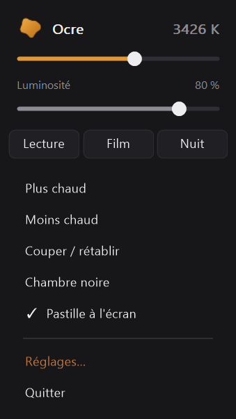

# Utiliser Ocre

[← Ocre](../../README.fr.md#documentation) · [English](../en/usage.md)

 

Filtre de lumiere chaude pilote au clavier, sur Windows 11.

| | Jeu principal | Jeu de secours |
|---|---|---|
| filtre moins fort | `Ctrl+F5` | `Ctrl+Alt+Retour arriere` |
| filtre plus fort | `Ctrl+F6` | `Ctrl+Alt+Entree` |
| coupe / retablit | `Ctrl+F7` | `Ctrl+Alt+Espace` |

Les deux jeux sont actifs en meme temps et entierement reconfigurables. Le
principal exige que le Fn-lock du portable soit en mode *touche de fonction*
(voir plus bas) ; le secours n'utilise aucune touche de fonction et marche
partout.

`Ctrl+Alt` + **molette de la souris** ajuste l'intensite en continu : un
reglage de ce genre se cherche plutot qu'il ne se saisit, et aucune touche ne
donne cette progressivite. La meme molette avec **`Maj`** en plus regle la
luminosite. Et la molette **sur l'icone** pres de l'heure, sans rien d'autre,
regle l'intensite aussi.

Un **clic gauche** sur l'icone ouvre les reglages, un **clic droit** un petit
panneau ou l'on regle l'intensite, la luminosite et trois prereglages sans rien
ouvrir, un **clic du milieu** coupe ou retablit le filtre -- Ctrl+F7 pour qui
a la main sur la souris. Interface en francais et en anglais.

L'intensite s'affiche en **pour cent ou en Kelvin** -- 3400 K parle a qui
vient de f.lux ou du Night Light, 58 % ne dit rien. Un clic sur la valeur, en
haut du panneau du clic droit, bascule de l'un a l'autre ; c'est le seul
endroit ou cela se choisit. Seul l'affichage change : le curseur, les
raccourcis et le fichier de configuration comptent toujours en pour cent.

Dans les fenetres, les **fleches** reglent le curseur vise, `Tab` passe de
l'un a l'autre, `Origine` et `Fin` vont aux bornes, `Echap` ferme.

Tout se pilote aussi en ligne de commande -- `Ocre.exe /set 40`, `/kelvin
3400`, `/preset nuit`, `/get` -- pour un boitier a boutons ou une macro.
